# Quick Tutorials / 快速教程

[English README](../README.md) · [中文 README](../README.zh-CN.md)

These GIFs are also available offline from **Tutorials** in the WebUI header:
choose an operation on the left and watch it on the right. Open the larger view
in a new window when you want to see the details. The joining guide is always
available. Four more Team Workspace lessons appear after joining a team.

也可在 WebUI 顶栏打开 **使用教程**，在左侧选择操作，右侧观看演示。所有 GIF 均可离线观看，也能在新窗口打开大图。「如何加入团队」随时可看，加入后还会显示四支团队空间演示。

Expand a task to view its GIF. These recordings use the EMP 0.14.3 interface with
sample data, a Chinese UI, and Chinese and English captions.

展开需要的操作即可观看 GIF。录屏使用 EMP 0.14.3 界面与示例数据，界面为简体中文，附中英字幕。

## GPT Models and Subscriptions / GPT 模型与订阅

1. Change Native GPT context / 修改 Native GPT 上下文

Use the gear on the Native row, edit the model's context window, and save.
The available limit comes from your account's model catalogue.

点击 **Native 行右侧的齿轮**，修改对应模型的上下文并保存。可填写的上限以自己账号的模型目录为准。

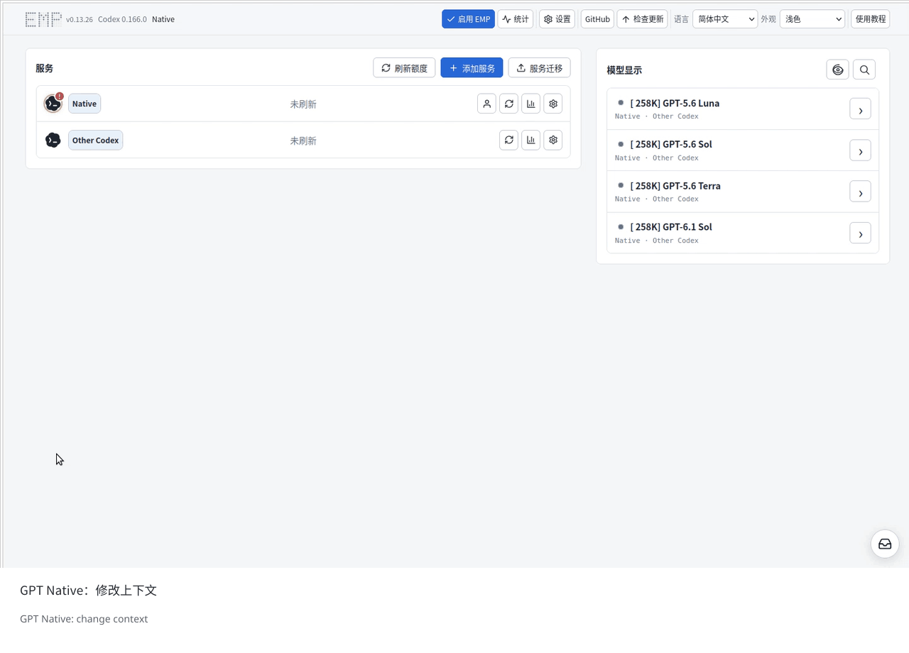

[View full size / 查看大图](assets/tutorials/00-native-context.gif)

2. Rename GPT models / 修改 GPT 模型显示名称

Use the arrow beside a model to change its display name. This example renames
GPT-5.6 Sol, Terra, and Luna to ☀️, 🌍, and 🌙, saving each one.

点击模型右侧箭头修改显示名称。示例把 GPT-5.6 Sol、Terra、Luna 分别改为 ☀️、🌍、🌙 并逐个保存。

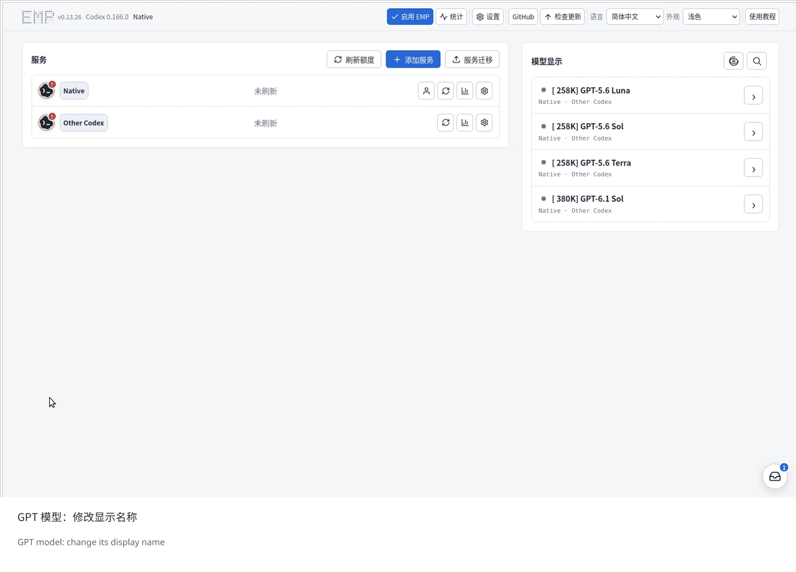

[View full size / 查看大图](assets/tutorials/00-native-name.gif)

3. Remove an imported Codex subscription / 移除导入的 Codex 订阅

Open the imported account and select **Remove** beside its information. Removing it from EMP keeps
the current Native sign-in.

点击导入的账号，在账号信息右侧选择 **移除** 并确认。本机 Native 登录保留。

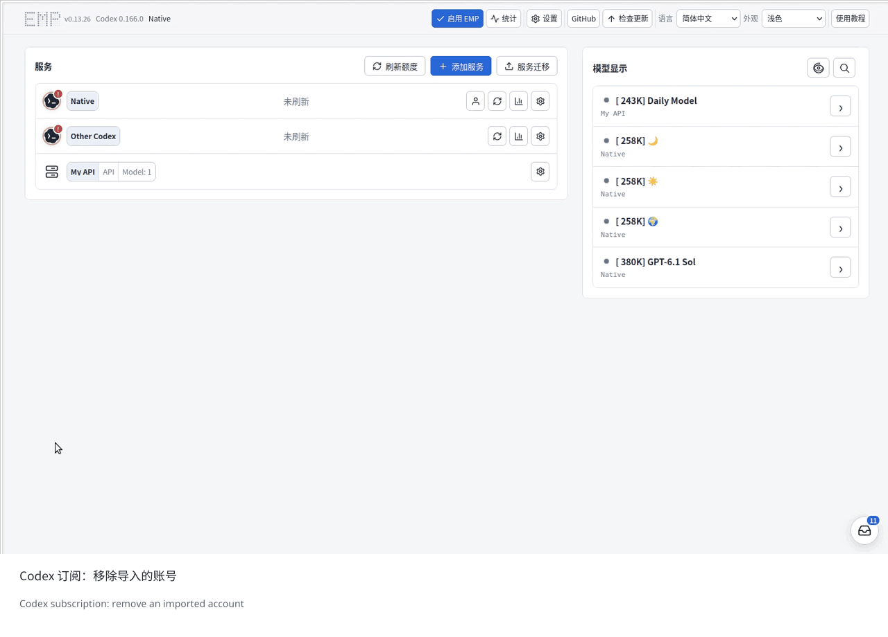

[View full size / 查看大图](assets/tutorials/00-remove-subscription.gif)

## External API Services / 外部 API 服务

4. Add a service / 添加服务

Open **Add service**, enter the connection details, save, then update the model
list and show the model you want to use. Preset services fill in their connection
details; use your own API key.

点击 **添加服务**，填写连接信息并保存，再更新模型列表、显示要使用的模型。预设服务会填好连接参数，填写自己的 API Key 即可。

For Mercury 3, select **Inception**, then import `mercury-3` from its
model list. [Inception API setup](https://docs.inceptionlabs.ai/get-started).

Mercury 3 可选择 **Inception**，再从模型列表导入 `mercury-3`。

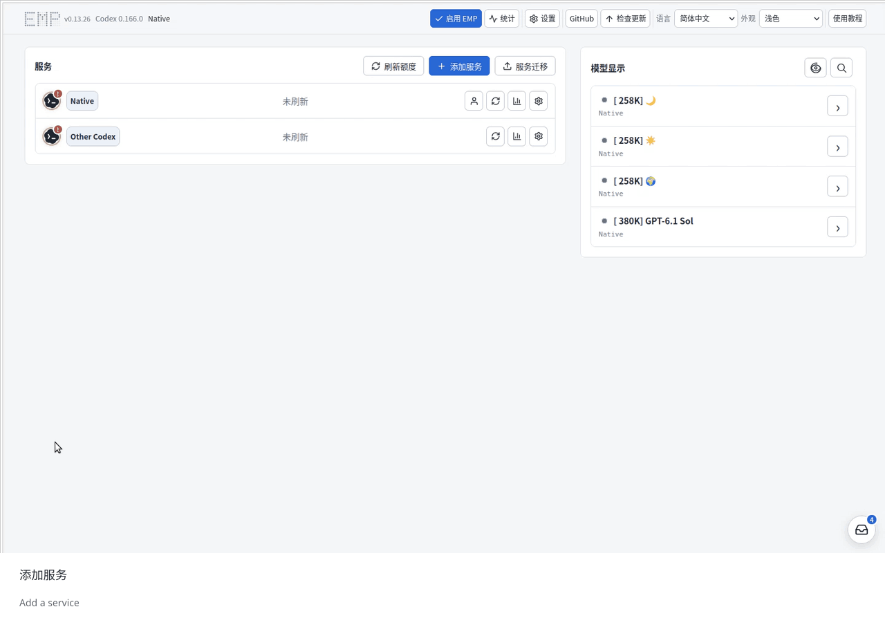

[View full size / 查看大图](assets/tutorials/01-add-service.gif)

5. Change an external model's context / 修改外部模型上下文

Open the service's **Model settings**, edit the model, set the supported context
window, and save.

打开服务的 **模型设置**，编辑模型，填写服务实际支持的上下文并保存。

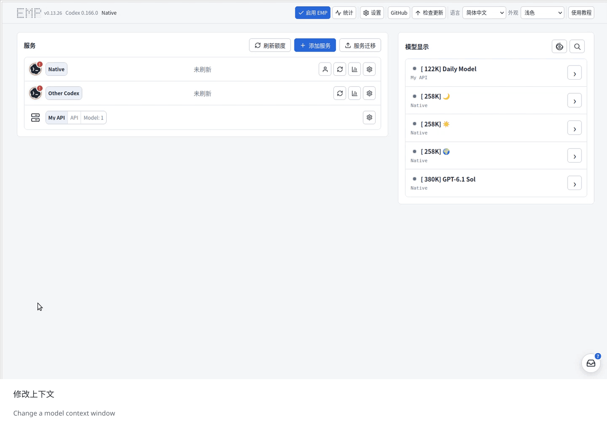

[View full size / 查看大图](assets/tutorials/05-change-context.gif)

6. Rename a service and a model / 修改服务和模型名称

Open the service details and use its gear to change the service name. Use the arrow beside a
model to change its display name; its upstream model ID stays the same. Service names must be distinct.

点击服务名称打开信息，再点击右侧齿轮修改服务名称；点击模型右侧箭头修改模型显示名称，上游模型 ID 保持不变。不同服务请使用不同名称。

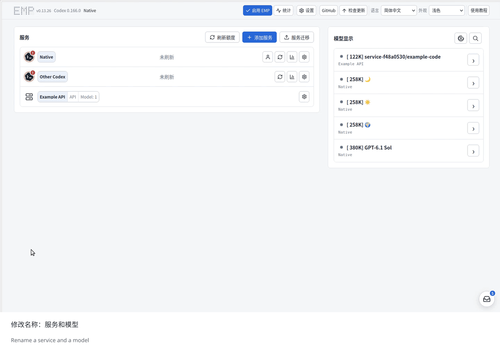

[View full size / 查看大图](assets/tutorials/06-rename.gif)

7. Remove an external service / 移除外部服务

Open the service, select **Remove**, and confirm. Its models are removed from
EMP with it.

点击要移除的服务，选择 **移除** 并确认，EMP 会同时移除该服务的模型。

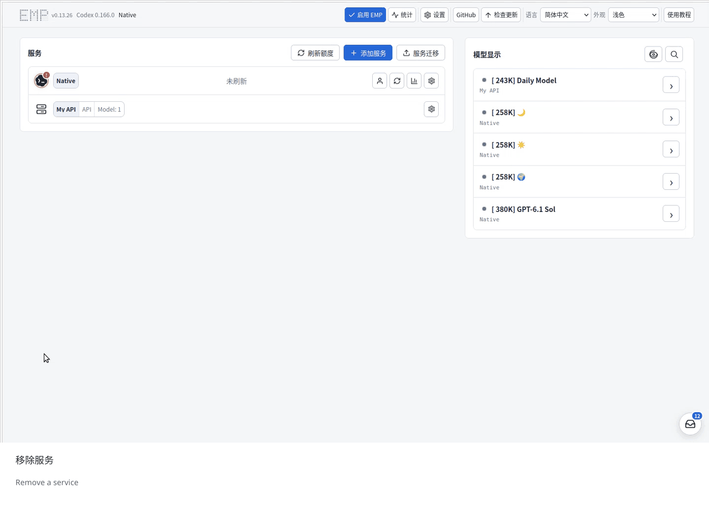

[View full size / 查看大图](assets/tutorials/04-remove-service.gif)

## Shared Controls / 通用操作

8. Show or hide context labels for all models / 切换全部模型的上下文显示

The eye control above the model list shows or hides context labels for both
GPT models and external models. It keeps the configured context windows.

模型列表上方的眼睛开关统一显示或隐藏全部 GPT 和外部模型的上下文标签，不改变实际上下文设置。

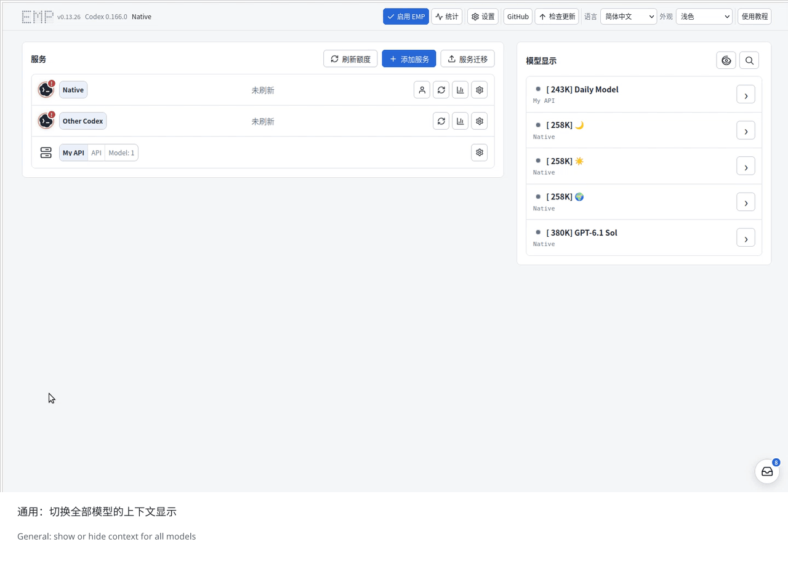

[View full size / 查看大图](assets/tutorials/07-context-label.gif)

9. Export subscriptions and external services / 一起导出订阅和外部服务

Open **Service migration**, choose the **File** card and **Export**, select the
services, set an export password, and download the `.emp` file. One package can contain both Codex subscriptions
and external API services. Keep the file and password together for importing.

打开 **服务迁移**，在 **文件** 卡片中选择 **导出**，勾选服务，设置迁移密码并下载 `.emp` 文件。同一个包可以包含 Codex 订阅与外部 API 服务；导入时需要该文件及密码。

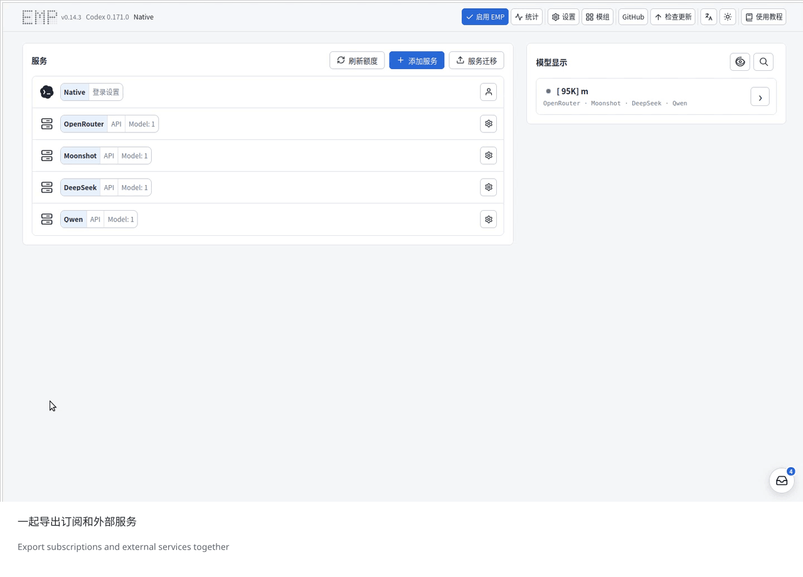

[View full size / 查看大图](assets/tutorials/03-export-service.gif)

10. Import subscriptions and external services / 一起导入订阅和外部服务

Open **Service migration**, choose the **File** card and **Import**, choose the
`.emp` file, enter its password, and open the package. Review and select the subscriptions and external services,
then select **Import**.

打开 **服务迁移**，在 **文件** 卡片中选择 **导入**，选择 `.emp` 文件，输入迁移密码并打开迁移包。核对并勾选订阅与外部服务后，点击 **导入**。

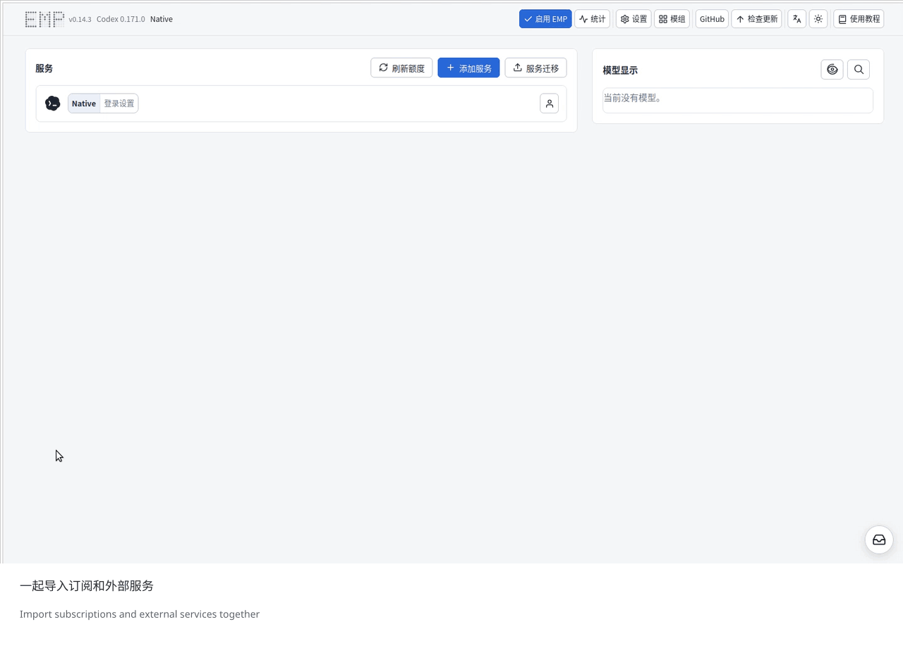

[View full size / 查看大图](assets/tutorials/02-import-service.gif)

11. Transfer over LAN / 通过隧道迁移

Connect both computers to the same LAN and open **Service migration → Local network**.
The demonstration shows the sender and receiver side by side.
On the sender, stay on **Send from this computer**, select services and choose
**Create transfer code**. The code appears in the notification island at the top;
copy it to the receiver. Codes expire after five minutes. On the receiver, open
**Receive on this computer**, paste the code and choose **Receive and preview**.
The sender's island then asks to **Approve transfer**; afterwards review and
confirm the import on the receiver.

演示将发送端和接收端并排显示。两台电脑连接同一局域网，打开 **服务迁移 → 局域网**。
发送端停留在 **从这台电脑发送**，勾选服务后点击 **生成迁移代码**，代码会出现在顶部灵动岛里，复制给接收端；
代码五分钟内有效。接收端切到 **接收到这台电脑**，粘贴代码并点击 **接收并预览**。发送端的灵动岛会弹出接收请求，点击 **允许发送**；
接收端核对预览后点击 **导入**，此时才会写入配置。

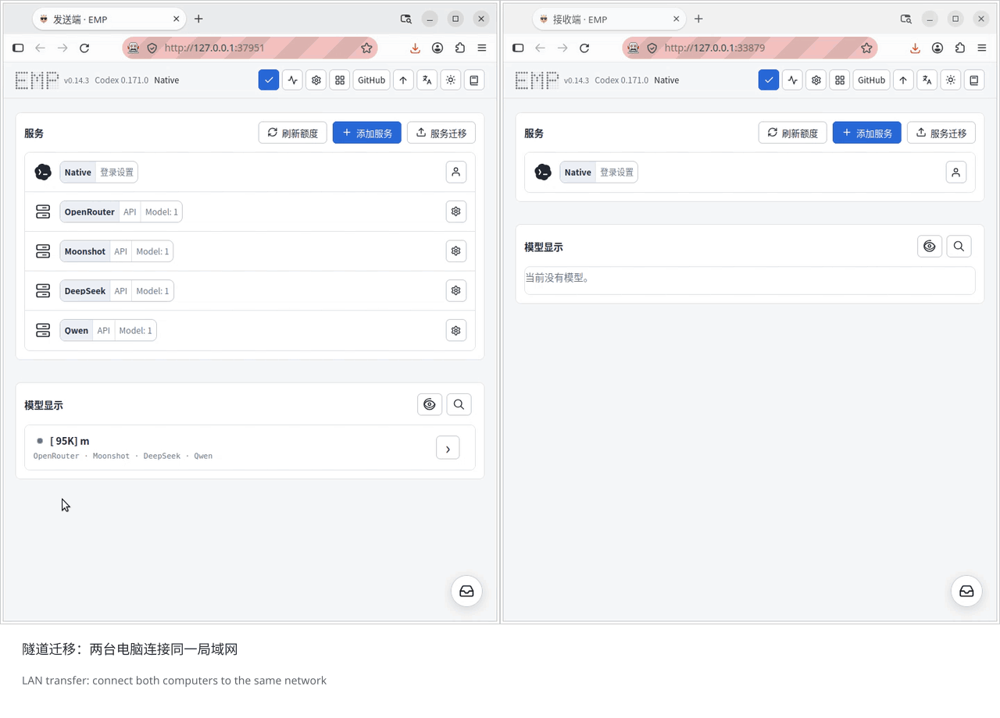

[View full size / 查看大图](assets/tutorials/08-tunnel-migration.gif)

## Team Workspace / 团队空间

### How to join a team / 如何加入团队

1. Open **Modules** in the WebUI header. Install and enable **Team Workspace**,
   then restart EMP if prompted.
2. In **Services**, open **Team Workspace**. Paste the administrator's full
   invitation into the **7-digit join code** field. With just the digits, choose
   a nearby workspace or enter its address using the gear button.
3. Enter your nickname, choose a username and password, and submit your request.
   An administrator must approve it before you can use the workspace.

1. 在 WebUI 顶栏打开 **模组**，安装并启用 **团队空间**。如果提示重启，请重启 EMP。
2. 从服务区打开 **团队空间**，把管理员发来的整段邀请粘贴到 **七位团队码**。如果只有数字，先选中附近的团队，或通过齿轮填写团队地址。
3. 填写昵称，设置用户名和密码，再提交加入申请。管理员批准后即可使用团队空间。

12. Explore the workspace and usage / 查看团队空间与用量

Open the team workspace from the header to see today's usage. Expand the usage
detail for each model, and open **Profiles** to see who is in the team.

从顶栏打开团队空间，查看今天的用量；展开用量明细可看到各模型的消耗，点击 **成员资料** 查看团队成员。

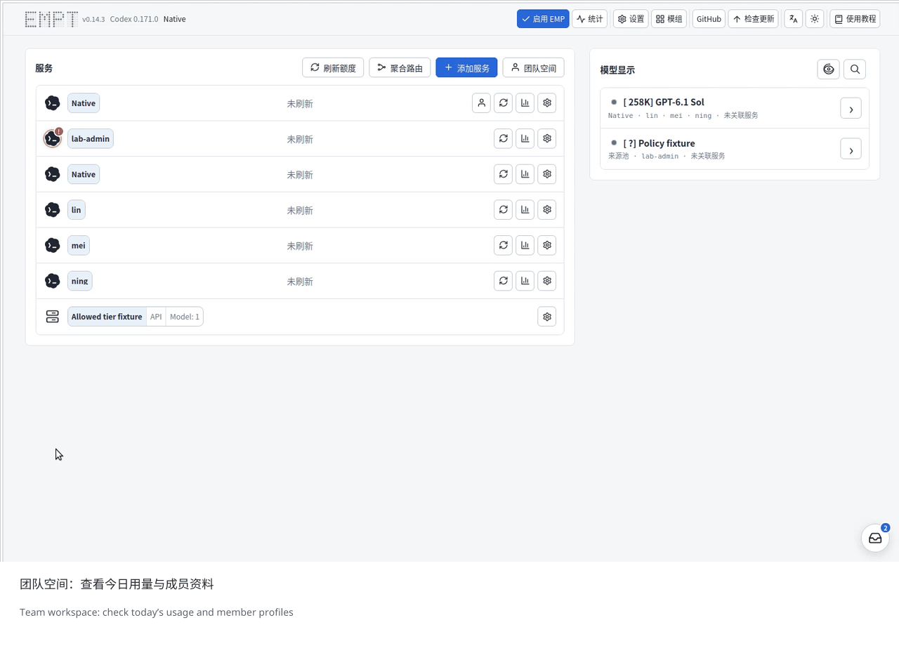

[View full size / 查看大图](assets/tutorials/09-team-workspace.gif)

13. Upload and sync subscriptions / 上传与同步订阅

With the matching permission, **Upload** shares one of your subscriptions with
the team and **Sync** brings the team's shared subscriptions to this computer.

拥有对应权限时，点击 **上传** 把自己的订阅共享给团队，点击 **同步** 把团队共享的订阅同步到这台电脑。

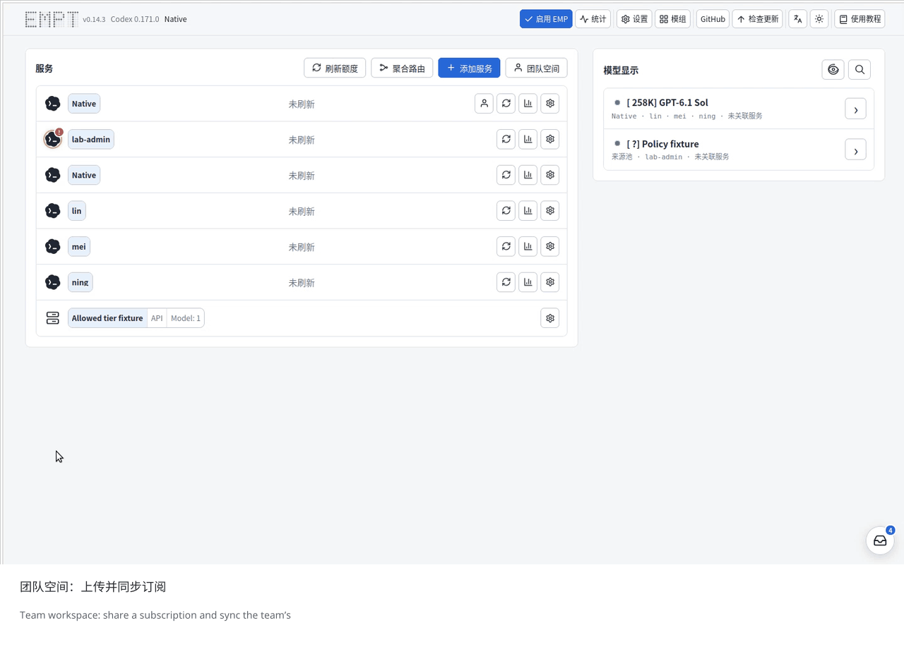

[View full size / 查看大图](assets/tutorials/10-team-share.gif)

14. Review join requests / 审批加入申请

Team administrators see each request as "Name wants to join" in the notification
island, with **Approve** and **Decline**. Up to three requests are shown at once;
the rest follow as earlier ones are handled.

团队管理员会在顶部灵动岛看到「某某 想要加入团队」，直接点击 **同意** 或 **拒绝**。灵动岛一次最多显示三条，处理后其余申请依次弹出。

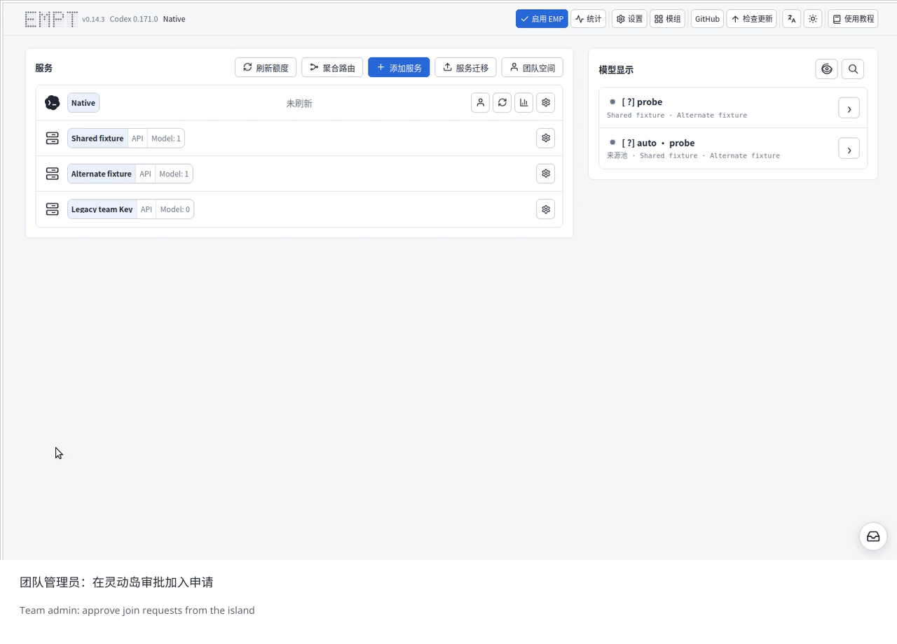

[View full size / 查看大图](assets/tutorials/11-team-approve.gif)

15. Manage member access and limits / 管理成员权限与额度

Open **Manage → Manage members**. Pending requests can also be approved here. Set each
member's daily USD limit and turn permissions such as Fast, Upload and Sync on or off.

打开 **管理 → 成员管理**，待审批的申请也可在这里 **同意** 或 **拒绝**；为每位成员设置每日 USD 上限，并开关 Fast、上传、同步等权限。

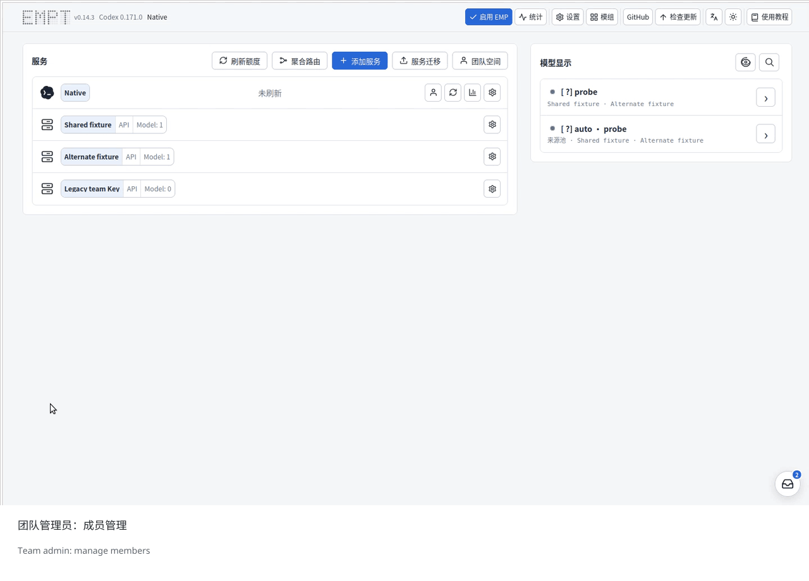

[View full size / 查看大图](assets/tutorials/12-team-members.gif)

