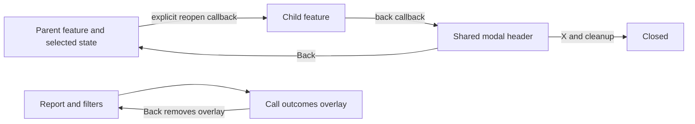
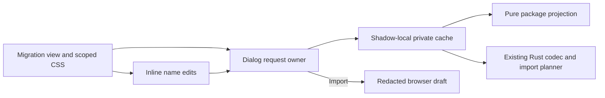
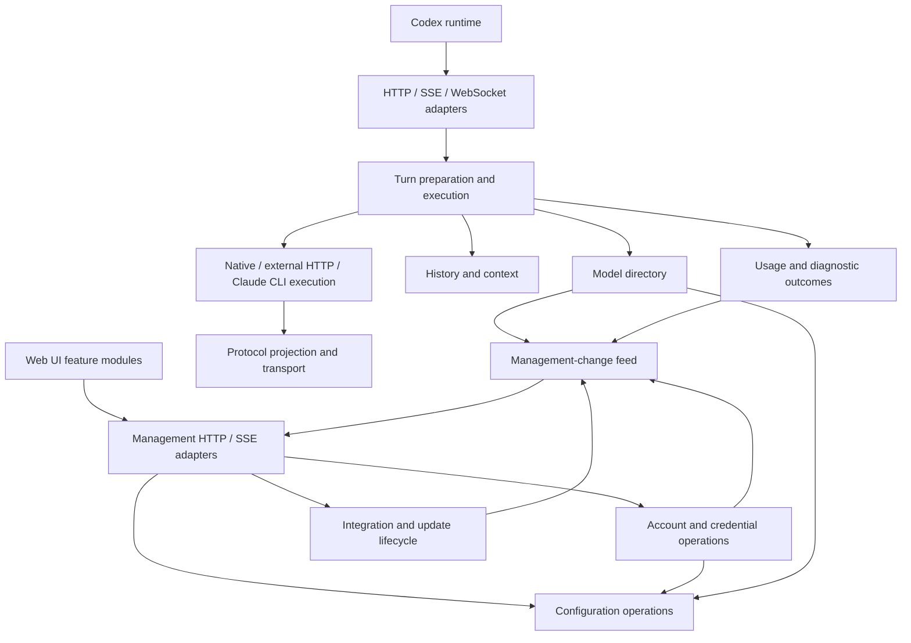
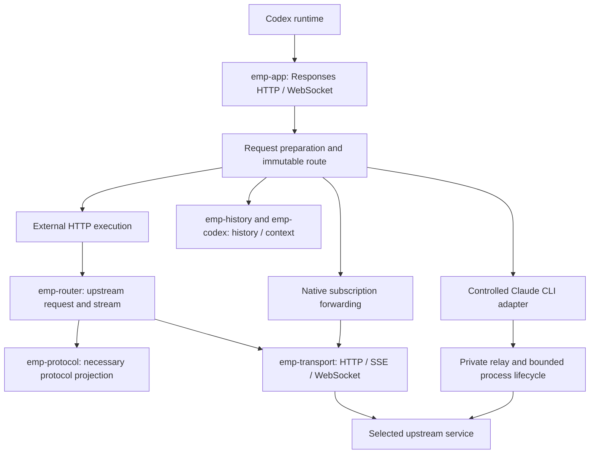
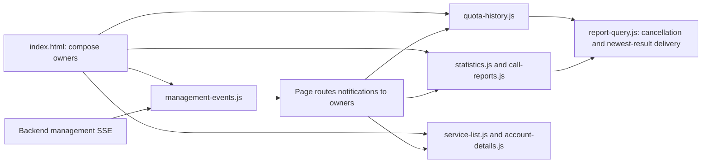
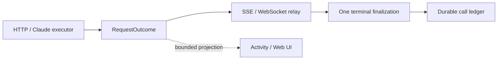

# Architecture assessment and refactoring direction

For the current crate map and the latest ownership changes, see
[Current architecture and lifecycle ablation](#current-architecture-and-lifecycle-ablation-2026-10-11).

Daily build/check scope, candidate E2E and cache retention follow the
[Rust development SOP](development-sop.md).

For the current whole-backend ownership contract, before/after diagrams and
acceptance checklist, see [Backend workflows](backend-workflows.md). The
assessment below records the earlier passes; availability gates, cooldowns and
recovery probes are outside the passive-observation refactor.

Assessment date: 2026-10-04. The findings describe the 0.12.9 source plus the
local profiling changes. The first ownership pass is implemented locally.
The continuation below deepens external request execution and error presentation.
This review traced application workflows and inspected all nine crate manifests;
it is not a line-by-line security audit or new cross-platform acceptance run.

## 0.13.0 accepted UI and response ownership (2026-10-12)

Formal and Shadow pages now share migration, model management, service presentation,
subscription settings, connection forms and update controllers. Shadow supplies
isolation and demonstration adapters only; accepted UI assets have one source.
The page composes stable feature interfaces rather than replacing their functions
at runtime. Subscription preference projection is pure; each modal controller
owns cancellation and rejects replies for a closed or replaced window.

Removing the retired homepage model list exposed a real dependency: the motion
owner attempted to observe a missing element and stopped page initialization.
Motion now observes only existing targets. The retired checkbox-manager test was
replaced with current manager cancellation/stale-reply acceptance. Meaningful
protocol, history, credential and rollback tests remain. The smaller entry files
are a navigation improvement; no repository-wide independence or CPU/RAM gain
is claimed.

Formal migration previews keep decrypted packages server-side, at most four for
30 minutes, bound to the authenticated management session. The browser receives
an opaque token and scrubbed metadata. The pure Rust selection owner excludes
unselected services, models and credentials. Import uses existing account locks
and transactions; observation retains separate commit/catalog publication stages.
While Import commits, the browser locks selection, naming, options and Back/Escape.
Submission does not share the preview's cancellation signal: cancelling a preview
cannot discard the result of a committed import. Successful submission reloads the
configuration and closes only the same import view.
File and LAN input share the preview cache's binary decode/validation boundary;
LAN delivery passes the encrypted bytes directly, without a Base64/JSON roundtrip.
The cache moves each decoded payload into storage after deriving the scrubbed
response. The HTTP adapter authenticates the management session once and passes
that identity through each operation.
The Shadow bridge keeps its own read-only cache and never forwards a write.
Its fetch adapter adds the scrubbed browser draft for preview/demo requests;
formal requests use the backend configuration and carry no browser snapshot.

The HTTP response owner now contains decoded reads, size/deadline enforcement and
bounded cleanup. Requests negotiate gzip, Brotli, Zstandard and deflate; reqwest
streams decoding and removes encoded length/encoding headers. Caller-provided
`Accept-Encoding` is retained. General API request compression and downstream
response compression are not added. Existing native zstd requests and WS behavior
remain. Codec tests require the first SSE event before upstream EOF, validate
limits/corruption and compare synthetic encoded bytes; this is not a WAN savings
estimate.

## Decision

Redesign application ownership incrementally. Retain the existing protocol,
history, transport and integration implementations behind their useful
interfaces. A replacement of the entire backend is not justified by this review.

The main problem is knowledge shared across callers: handlers know credential
hydration, route selection, history preparation, configuration locking and
notification mechanics. Moving these functions into more files would leave
that problem intact. A successful refactor makes a caller know fewer rules.

The design reference is [Codebase Design](https://github.com/mattpocock/skills/tree/main/skills/engineering/codebase-design).
Use small interfaces that hide substantial behavior; test through those
interfaces. Evaluate an abstraction by what deleting it would force its callers
to implement. File length is a navigation signal, not a measure of module depth.

## Existing structure worth retaining

| Module | Existing responsibility | Decision |
| --- | --- | --- |
| `emp-core` | Route identities, bounded opaque model/provider data, capability views | Retain; preserve unknown fields |
| `emp-protocol` | Responses, Chat and Anthropic projections and stream state | Retain protocol-specific state machines |
| `emp-history` | History preparation, tool pairing, context and compaction algorithms | Retain the `HistoryReader` interface and pure algorithms |
| `emp-transport` | HTTP pools, proxy/TLS policy, admission, framing and WebSocket pump | Retain; profile resource ownership before changing execution model |
| `emp-router` | Protocol selection, projection and upstream execution | Retain; consolidate application attempt orchestration above it |
| `emp-codex` | Codex catalogs, concrete history access, quota helpers and runtime discovery | Retain concrete Codex integration; reduce application callers' knowledge of its storage details |
| `emp-integration` | Configuration leases, conflict detection and recovery | Retain transactional ownership |
| `emp-state` | Configuration, vault, transactions, plus update/usage/diagnostic subsystems | Narrow application access first; do not create new crates merely to redistribute files |
| `emp-app` | Composition, HTTP/UI, request orchestration and mutable services | Primary refactoring target |

No library crate depends on `emp-app`. The principal layering leaks are inside
the application, where most modules can access the complete `ServerState`.

## Findings

### 1. Request preparation and external attempts have explicit owners

[`api/responses.rs`](../crates/emp-app/src/api/responses.rs),
[`api/websocket.rs`](../crates/emp-app/src/api/websocket.rs) and
[`api/compact.rs`](../crates/emp-app/src/api/compact.rs) now use
[`request_preparation.rs`](../crates/emp-app/src/services/request_preparation.rs)
for one request-local configuration, credential hydration, route selection and
summary policy. History/context preparation and transport presentation remain
at their existing boundaries.

The same request preparation owner applies an external model's configured
`output_limit` to `max_output_tokens`, retaining a smaller caller limit. An unset
limit leaves the request unchanged, and Native requests bypass this adjustment.
History budgeting and all wire projections therefore observe one output cap.

[`external.rs`](../crates/emp-app/src/services/external.rs) now owns complete
Responses execution and stream opening. The two operations share a private
attempt implementation: candidate selection, retry bounds/delay, context-error
feedback and retry receipts no longer live in the HTTP adapter. Complete
execution owns one outcome and its activity guard; an opened stream transfers
completion accounting to its existing relay. HTTP and WebSocket relays own one
activity guard across opening, delivery and cancellation, so the shared attempt
loop must not start a second guard while waiting for upstream headers. Optional disconnect monitoring
replaces the two previous opening wrappers and duplicated SSE caller branches.

Its interface returns the existing response/stream and typed failures. It does
not impose a new message schema on native or external data. Native forwarding,
external HTTP and Claude CLI execution remain concrete; Claude now returns its
completion directly, without a single-variant result wrapper. Initial request
preparation and the transport adapters still retain their actual responsibilities.

Preserve meaningful differences: compact does not currently apply auto-review
routing; WebSocket checks incremental-request scope before history replay;
protocol fallback must stop after output or tool side effects. Connection-local
WebSocket continuation stays in the WebSocket adapter. Share these operations
without replacing them with an oversized universal pipeline.

### 2. Configuration ownership leaks through raw locks

The original [`ConfigurationState`](../crates/emp-app/src/services/configuration.rs)
exposed its mutex from the provider forwarding module. The assessment found
direct configuration-lock access in 24 application source files, excluding
dedicated test files but including inline test code. This was a coupling signal,
not proof that 24 modules must change together.

Configuration publication is repeated in catalog edits, account operations,
quota status, protocol observations and context calibration. Callers must know
when to validate, persist, reload, release locks and notify other services.

The configuration module now owns a private mutex and durable commit/reload.
Readers receive snapshots or read-only guards; only services can acquire an
edit, and memory changes are published after commit succeeds. Settings commands
own validation and post-commit work; account import/removal/migration retain
credential locking and account-state settlement. HTTP handlers receive results
without orchestrating transactions. CLI listener overrides are an explicit,
non-persistent startup operation. Raw mutation is available only to test fixtures.

Preserve refresh-lock -> configuration-lock -> history-store-lock ordering,
transaction rollback and credential-rotation draining. A failed validation or
commit must not publish success. Keep flexible stored JSON and opaque upstream
fields; typed commands/results need not impose a closed schema on provider data.

### 3. Management events borrow the quota module's synchronization

Originally [`ActivityService`](../crates/emp-app/src/services/activity.rs)
required callers to supply the quota revision mutex and condition variable;
usage and runtime updates also borrowed it. The assessment found those wake
references in 14 application source files under the same counting rules as above.

This is already an event-driven wait with a keepalive deadline, not a repeated
quota fetch. The ownership and interface are the problem.

[`ManagementEvents`](../crates/emp-app/src/services/management_events.rs) now owns
the quota, activity, usage and integration revisions, subscriber limit and
shutdown wake. Activity and usage receive it at construction; request callers
no longer supply quota locks. Subscriptions check and wait under the publisher's
lock to prevent lost wakeups. SSE event names and snapshot behavior are unchanged.

State-change notices may coalesce: the consumer reads current state. Commands
that change accounts, consume a reset, install an update or request a scan must
retain a result or an accepted/running/completed/failed receipt. Waking a worker
does not prove command completion. Do not replace these distinct semantics
with a universal fire-and-forget bus. Quota deadlines remain scheduled work.

### 4. Model-directory operations own source collection and publication

[`catalog`](../crates/emp-app/src/services/catalog.rs) now owns public catalog
assembly, model lookup, subscription options, validation and selection commits.
Its private `CatalogSources` reads native data once per operation and account
credentials once, reusing those credentials for identity matching and duplicate
detection. Missing account caches reuse that operation's native fallback.
HTTP adapters no longer assemble catalog sources or publish configuration.

[`account_catalog`](../crates/emp-app/src/services/account_catalog.rs) retains
background refresh scheduling and identity-checked persistence. This is not a
long-lived response cache: external Codex catalog changes remain visible.
Further caching requires a complete invalidation rule for configuration,
credentials and external files. Measure before introducing that mechanism.

### 5. Workflow outcomes and wire rendering have explicit owners

[`RequestOutcome`](../crates/emp-app/src/services/request_outcome.rs) owns a
request's terminal result. It updates auto-review eligibility through
`ReviewState`, then submits content-free usage/diagnostic evidence. The
observation reporter no longer decides routing cooldowns or owns their locks.
Network evidence lives below the HTTP support-report adapter.

[`request_facts`](../crates/emp-app/src/services/request_facts.rs) owns the pure
request classification shared by accounting, memory routing and passive receipts.
Accounting no longer imports parsing from either observation or routing policy.
It classifies memory jobs once per outcome and moves the fact map into the event
without cloning it. Request preparation validates the body object at entry;
external presentation settings receive that object directly and take ownership
of its reasoning fields instead of copying them.

[`RequestObservation`](../crates/emp-app/src/services/observation/request.rs)
separately owns a client request's passive receipt, from entry through the last
downstream write. It receives only diagnostic storage, safe route facts, named
phases and write results; it has no routing, retry, account or usage controls.
HTTP Responses and Compact borrow the entry owner's receipt. Each WebSocket
turn owns a new receipt and an observed sender, linked to the connection receipt.
The same server-generated request ID links preparation, executor attempts,
existing model outcomes and downstream delivery. Early rejection also has a
receipt, even when no model outcome exists.

This separation matters when an upstream terminal event is received but writing
it to the client fails. `RequestOutcome` preserves the upstream result and its
single accounting entry; `RequestObservation` records the failed write. It does
not reinterpret success, update eligibility, replay output or switch sources.
The [journal contract](diagnostic-journal-spec.md#request-receipt-contract)
defines what each observation proves and the remaining unknowns.

Probe classification belongs to `emp-state::diagnostics::MODEL_TEST_OPERATIONS`;
request admission, receipt creation, accounting and reports share it. Journal
writing/redaction and bounded replay have separate owners within the same module.
Replay separates probes before applying the ordinary-request retention limit.

Native complete/compact forwarding now returns the existing structured result
(status, raw body, content type and preserved headers). The native API renderer
formats HTTP bytes. History/context and external-compaction failures likewise
cross the service boundary as typed errors; their API adapter renders HTTP and
stream failure events. Original status codes, retry decisions and wire fields
remain part of the endpoint contract. Allocator page release is shared utility
policy, not a dependency on HTTP request parsing.

Application router and Claude failures are rendered by the API modules.
Claude execution retains public error classification for its accounting, while
HTTP and WebSocket presentation use that classification through the same small
interface. Subscription catalog refresh also returns a typed failure; its HTTP
adapter owns the status and JSON response. Generated SSE delivery belongs to
the streaming adapter. These execution modules no longer import API or HTTP
response helpers; the private Claude loopback relay still implements its own
HTTP transport as required.

Complete Responses JSON is converted by a pull-based iterator in `emp-router`.
Native and external JSON fallback, generated HTTP SSE, and Claude WebSocket
delivery request one event at a time. Each consumer writes before requesting
another event, so a blocked or closed downstream does not build the remaining
event sequence. Structural validation is separate from event generation; a
non-streaming Claude reply no longer generates and discards an SSE sequence.
The iterator validates the source once and yields events without imposing a
cumulative output-byte limit. Delivered bytes no longer occupy this iterator's
memory. A failed downstream write drops it, so the remaining events are never
constructed. No producer task or channel is needed for this synchronous path.
The complete source JSON, current event and encoded frame still require memory;
this does not impose a process-wide byte budget across admitted requests.

This follows the consumption model in Codex's `codex-api/src/sse/responses.rs`
(reference checkout `5b0b253035`, updated 2026-10-07): await bounded-channel sends and stop when the
receiver closes. EMP's writer supplies that backpressure directly. Ordinary
JSON body and retained protocol-state limits remain separate from event delivery.
Native SSE limits the event being parsed, rather than cumulative delivered bytes;
the ordinary JSON fallback still has its body limit. Declared SSE does not retain
a second copy of the received body. Native and external Responses stop at the
first terminal event, release upstream work and ignore trailing data, rather than
waiting for EOF or draining the socket. Unknown fields, `partial_answer`,
`end_turn` and interrupted-response metadata remain in the wire response.

### 6. Cancellation follows transport ownership

Native Responses WebSocket turns use a socket-readiness loop in
[`websocket/duplex.rs`](../crates/emp-app/src/api/websocket/duplex.rs).
It reads both directions on the connection's existing thread, including data
already buffered in TLS or frame decoding. It does not add a producer task,
periodic polling worker or upstream event queue. Reads drain available bytes in
nonblocking mode, then restore blocking mode before frame writes. Receive
timeouts are left unchanged; readiness registrations are removed at turn end.

Codex's `response.interrupt` is forwarded through the active upstream connection;
that upstream owns response-ID validation and acknowledgement. An incomplete
response with reason `interrupted` remains a valid incremental continuation base,
as in Codex's current Responses client, without being counted as successful
context calibration. A pipelined next request is held in one slot and re-enters
normal route/scope validation after the current terminal. Downstream closure
cancels a silent upstream. Once an incremental request receives an upstream
event, a broken connection is reported as an incomplete stream, not as a missing
previous response that instructs Codex to replay the request.

HTTP fallback, external HTTP streams and the single-step Claude CLI also accept
Codex's steering control (`response.interrupt`, `discard_partial_items`). During
these turns, a temporary readiness worker owns the existing frame decoder;
the output writer retains its connection, and complete frame writes are
serialized with control replies, pongs and temporary read-mode changes on cloned
TCP handles. The worker waits for socket events,
retains at most one next request, then returns the decoder, including buffered
or partial frames. It is joined before the next turn begins.

A matching active response ID cancels the owned upstream operation through the
existing cancellation signal. Further output is discarded, and EMP sends
`response.incomplete` with reason `interrupted`, the same response ID and
`end_turn: false`. Claude publishes its projected response ID before its buffered
inference so steering can cancel the CLI process tree and relay. Incorrect
targets are rejected; late interrupts for the preceding terminal are ignored.
These adapters have no resumable upstream WebSocket state: an incremental
continuation receives `previous_response_not_found`, allowing Codex to resend
full history; the client may switch to HTTP for that recovery. A `generate: false`
warmup returns an empty response ID because no resumable state exists. Codex then
sends the complete first request instead of referencing an invented checkpoint.
Native WebSocket continuations still use the upstream state. EMP does not invent
usage for cancelled inference.

Native WebSocket forwarding delegates connection identity and scope checks to
`native_socket/connection.rs` and error projection to `native_socket/errors.rs`.
Large native full-history requests use the pure planner in
[`native_socket/prefill/plan.rs`](../crates/emp-app/src/api/websocket/native_socket/prefill/plan.rs);
`prefill.rs` owns only the generation-free exchange and its failure handling.
The plan borrows the original history and allocates one outgoing batch at a time.
It partitions whole input items under an 8 MiB decoded JSON message budget,
keeping client tool calls/results together and repeating the original request
instructions and controls. Prefixes use `generate:false`; each must finish with
an upstream response ID, empty output and no reported output tokens before the
next chunk references it. Only the last chunk uses the caller's generation flag
and reaches downstream projection/accounting. Later turns retain the resulting
upstream connection and prior ID. No history is cached on disk or removed to
achieve smaller messages. The budget is EMP policy, not a published upstream
limit; warmup round trips increase initial setup latency.

This avoids the old oversized-message loop: a pre-event 1009 led to full HTTP
fallback, whose successful response did not create reusable WebSocket state;
the next incremental turn required another complete history. Incremental
requests are never partitioned or stripped of their prior ID. An individually
oversized item, unpaired tool history or unknown tool protocol retains the
existing fallback behavior, so such histories can still require full recovery.
Prefill rejection, unexpected generation and transport failure terminate the
attempt without automatic replay. Downstream disconnect releases the same
upstream owner. Scope/route/credential mismatches still reject continuation;
locally rejecting an incompatible request no longer erases an otherwise valid
base. Explicit `previous_response_id:null` remains a full request.

Some native backends reject supplied input IDs with the explicit
`unsupported_parameter` / persisted-item lookup error. Before any response
creation or generation event, the native WebSocket owner can resend once after
removing IDs only from complete inline messages and tool declarations. It
retains message content/phase, tool call/output IDs, opaque items, references and
`previous_response_id`. The adaptation is remembered on that upstream socket
and resets with its route/credential owner. Generic errors and failures after
response creation are never replayed by this policy. The rejected send and
recovery share one operation/usage receipt, with both dispatches counted.

The [continuation receipt contract](diagnostic-journal-spec.md#native-continuation-receipts)
separates local rejection, actual upstream rejection, connection reuse and byte
layers. Production acceptance must compare the same account/client workload;
synthetic traffic reduction alone does not certify an installed binary.

Control frames are logged separately from model requests. Active interruption
uses `client_cancelled` and the call state `interrupted`; a disconnected client
retains its separate cancellation classification. This follows Codex's
2026-09-26 steering change (`12de0e395d`, PR #48508), without a new version gate
or setting.

Real Codex app-server tests drive `turn/start` and `turn/steer` through isolated
EMP servers and synthetic upstreams. Codex's own `instant_interrupt` feature and
the model's `use_responses_lite` capability determine whether it sends an
interrupt or drains the current response before applying steering. EMP does not
change those client settings. The tests also distinguish a Codex RPC rejection
for a wrong turn ID, which never reaches EMP, from EMP's request validation.

Typed errors generated by the router, history and Claude adapters carry an
`origin` and a readable source prefix: EMP validation/adaptation, upstream
service, connection, or Claude Code CLI.
CLI errors identify the observed CLI boundary; a CLI failure alone does not prove
whether its service rejected the request. Native upstream events remain intact.
The delivery receipt records `response_error` with request/connection IDs, phase,
error code, origin and local write result, without copying the error message or
request body. Upstream receipts take provenance from the receiving boundary,
ignoring any upstream `origin` claim. Unclassified errors stay `unknown`.
Call records retain origin and the separate downstream delivery facts in the
existing usage database. A local write result is not a client acknowledgement.

[`DisconnectMonitor`](../crates/emp-app/src/services/disconnect.rs) starts its
worker lazily and waits on interruptible socket readiness. Drop wakes and joins
the worker without detaching it or shutting down the shared downstream socket.
Queued bytes and the previous read timeout are preserved. A bounded peek remains
as a backstop after readiness; ordinary idle waits no longer depend on that timeout.
Linux cancellation and teardown contracts pass locally. Native package checks
also run the disconnect contracts on Windows, Linux and both macOS architectures.
See [profiling evidence](performance-profiling.md) for the local measurements.
Changing all HTTP handling to an async framework is a separate decision, not a
prerequisite for the ownership fix.

Claude's request-local relay uses socket readiness and a cancellation signal
shared with its async upstream operation. Cancellation wakes idle accept,
header/body reads and blocked writes; late subscribers observe the same signal.
One absolute deadline bounds each relay read/write operation. The CLI process
monitor retains its bounded exit polling. This does not change subscription
sampling schedules or introduce an application-wide event framework.

CLI-added date reminders are normalized at this same relay boundary for text
and multimodal requests. Only the observed fixed reminder format with a valid
calendar date can move into system metadata. User text, media order and tool
history still have to match the prepared transcript; an arbitrary extra block
or a modified transcript remains an error.

### 7. Frontend features own private state and explicit dependencies

`i18n.js` formats copy registered by the `copy-*.js` dictionaries. UI templates
and event handlers reference stable keys through `tr`/`t`, passing named values
for dynamic text instead of embedding Chinese/English sentences. Keep both
locales and their placeholder names together in the owning feature dictionary;
the copy contract checks missing keys, duplicate keys and placeholder parity.
Protocol identifiers and backend-localized data remain data, not translated
identities. Startup recovery loads only its formatter and recovery dictionary;
Shadow copy stays in its preview scripts and is absent from the shipped asset
routes. Static labels use the existing `data-i18n` attributes.

The UI still consumes the same HTTP/SSE endpoints. `management-client.js` owns
session storage, bootstrap exchange, request authentication and API errors.
`settings.js`, `call-reports.js` and `diagnostics.js` own their feature
operations; request selection, diagnostics timers and late-response guards are
private. The page supplies current-state/language getters and UI operations.
A changed language or new configuration therefore does not leave a stale copy
inside a feature.

`notifications.js` owns transient WebUI messages and their browser-local inbox.
Existing callers retain `notice(message, error)`; they do not manage timers or
storage. One animated progress bar controls dismissal (five seconds normally,
ten for errors), pausing on hover, keyboard focus, window blur and hidden tabs.
The top capsule is a manual native popover; the inbox uses an independent auto
popover, so Escape/Close leaves an underlying editor and its draft intact.
The last 50 plain-text messages, timestamps and read states are stored per
browser origin. Storage failure falls back to the current page's memory. Clearing
the inbox is explicit. Both notice paths share one owner; legacy toast styles
and presentation overrides are removed. Interaction references:
[Radix Toast](https://www.radix-ui.com/primitives/docs/components/toast) and the
[native Popover API](https://developer.mozilla.org/en-US/docs/Web/API/Popover_API/Using).

`report-query.js` owns cancellation and latest-result selection for usage and
call/performance queries. Its interface is `run`/`cancel` plus result/state
callbacks; callers do not coordinate request counters. Refresh failures retain
the displayed data. `period-controls.js` supplies the same presets, explicit
custom-date query and refresh behavior to all time-based views. `usage-report.js` now owns its payload, scan request, fallback timer and pricing
save lifecycle behind `open`/`refresh`/`stop`. It reads configuration and language
through getters and receives period controls explicitly. DOM actions stay inside
the report root instead of adding page-level usage handlers.
`account-details.js` owns account usage reads and alias interaction. It retains
compact lifetime aggregates per account in page memory for one minute. Tab changes
detach the view while an in-flight read completes for that account; reopening
renders cached aggregates immediately. Usage events invalidate freshness and
refresh only the visible account, coalescing events during a read into a follow-up.
Expired data stays visible during refresh; failures preserve it with an error,
while authorization failures clear it. Account identity metadata changes, removal,
and the import/sign-in workflow discard affected cached data. Reconnecting the
management stream invalidates freshness. Cached report series are not retained.
`model-editor.js` owns the model draft, capability edits and metadata cancellation.
`model-settings.js` owns cached/discovered lists. The page composes these owners
and calls their cleanup when replacing or closing a modal. Provider detail reads
also cancel on closure. Late query results, save errors and draft cleanup cannot
alter a replacement window. Configuration persistence, formatting policy and
model inference remain existing shared operations; they are not duplicated.
The output-limit editor uses the existing configuration provenance owner; it
does not keep a second frontend source-of-truth for advertised versus manual
limits. `usage-data.js` supplies the common value formatter for service/model
tables, overview totals and session bills. Aggregation sums coverage counters
alongside usage: absent usage is `—`, reported zero is `0`, and partial totals
carry the existing coverage marker.
Performance navigation stays mounted during data refresh; overview metrics are
plain facts rather than six equivalent navigation buttons.

Raw stream observations own first/last content timing before projection. Outcomes
combine those timestamps with reported usage, preserving whole-call speed and a
separate generation rate. The ledger owns aggregates; frontend controllers only
format them. Missing stream timing never falls back to the old whole-call rate.
`request_outcome/performance.rs` owns operation timings and rate validation;
the outcome finalizer only coordinates accounting, publication and completion.
See [performance metric fields](diagnostic-journal-spec.md) for the wire contract.

Dialog navigation passes an explicit `back` callback to the shared modal shell.
The parent supplies a `reopen` callback for child transitions; service tabs carry
their service identity and selected tab. Root dialogs hide Back, while X clears
navigation and closes the dialog. Replacing a view runs its existing feature
cleanup. Model editing uses this shell instead of separate shadow header buttons,
retaining its manager search on return. The call-outcome dialog remains an overlay:
its single Back control or Escape removes it without rebuilding the report.
Root dialog close controls remain separate. Headers stay outside the scrolling body.

HTTP error serialization shares a status/body/retry-header function.
`api/failure_response/stream.rs` owns the common SSE/WebSocket error detail;
WebSocket does not allocate an SSE envelope to extract that detail. Native
pre-output conversion reuses the router's bounded Retry-After parser. Wire
contracts remain distinct and are exercised at the actual server interface.

Styles are embedded as a separate static asset in their original cascade order.
All assets ship in the EMP executable, with no new framework, development server
or frontend build pipeline. Existing page event handlers bind the features'
public operations. Shared dialogs, account presentation and migration controllers
keep rendering and state ownership in their respective modules.

Behavioral checks exercise login expiration versus upstream authentication
errors, expired bookmarks, rejected settings, current activity
snapshots, diagnostics close/cancel behavior and the shipped script order.
The real server test also fetches the page's referenced assets before login.

#### Frontend development and acceptance

Settings uses four flat, labelled groups: display preferences; general startup
and cross-service collaboration; external-model web search; and native-service
compaction/routing. Grouping changes navigation only. Existing controllers keep
their persistence and validation ownership; display choices remain browser-local,
and Auto Review, image and memory routes retain one shared child dialog.

The shared dialog shell keeps its title, navigation, service tabs and footer
outside the scrolling `.modal-body`. Migration, tutorials and service details
only customize their dimensions; the native request-outcome dialog uses the same
body rule. The shared body reserves a scrollbar gutter and spacing in the dialog's
outer padding, so a scrolling thumb does not touch controls or table content.
Migration bounds both the service selector and the resulting-service preview.
Service rows retain their natural height instead of shrinking inside a fixed-height
Flex column. The tunnel places selection/reception above a full-width transfer
area, with the code on the left and sender approval on the right. The code and
cancel action remain available during confirmation. Polling updates status without
scrolling or moving focus. Reception enters the shared import preview; only its explicit
confirmation writes configuration. State changes use the existing short opacity
transition and respect reduced motion.
Help bubbles state the behavior, triggering conditions and required action
directly. Keep factual limits and measured-data boundaries explicit;
avoid speculative explanations and repeated guarantee disclaimers. Maintain
Simplified Chinese and English together in the copy dictionaries.

Keep Shadow navigation stable across review rounds:

- Use **This update** for the current review and **Demos** for established examples.
  Do not append a new top-level button for each feature or change.
- Replace `reviewRows` in `scripts/shadow_frontend/preview-review.js` for each round.
  Describe the current candidate and link each item to its actual interface;
  remove superseded review labels and version/count claims from the active list.
- Keep released features available through Demos or their normal product entry.
  A new preview scenario belongs in those menus, not another toolbar button.
- Update both Simplified Chinese and English, the preview README, and affected
  browser checks together. Verify current entries, retained demos and narrow layouts.
- Preview navigation and synthetic adapters stay under `scripts/shadow_frontend`;
  promoting a feature must not include review buttons or demo state in product assets.

Default Shadow uses real management reads and candidate accounting over isolated
SQLite snapshots (`real_preview.py`, `real_snapshot.py`). The existing statistics
Refresh action replaces the snapshot; an unsuccessful refresh retains the previous
one and reports the failure. Copies retain original names, missing fields and
parent relationships. No preview adapter may fill them in to make the bill appear
correct. Credentials and rollout bodies are excluded, and production receives
only allowed GET requests. Account-scoped usage uses the running backend only
to resolve the current opaque owner fingerprint, then calculates the report in
the candidate backend too. The authenticated usage API accepts either a local
account ID or an explicit owner filter, rejects ambiguous/oversized filters and
uses the same ledger selection in both cases. This avoids copying credentials or
guessing identity from cached labels. Browser drafts are private to each launch.
Statistics use the product usage API in both preview modes. The retired Python
aggregation endpoint is removed; the bridge does not maintain a second selection,
pricing or conversation-attribution implementation.

`local_backend.py` owns local HTTP requests and disposable EMP process startup,
environment isolation and cleanup. Real snapshots use it directly. The acceptance
fixture composes the same launcher with its synthetic upstream and sample config;
real snapshot refreshes do not import that factory or start its unused server.

Synthetic demos require explicit selection and a separate disposable origin;
they offer a return to real data. They cannot be the default review, silently
replace failed reads or serve as evidence of real-data accounting correctness.
Both pages share one navigation table (`preview-review.js`). Demo-only scenario
handlers (`preview-actions.js`) and lifecycle simulation (`preview.js`) stay off
the real-data page. Navigation
consumes a deep link once after the first successful configuration render, without
readiness polling or chained dispatcher replacements. Preserve the gallery write
guard and the help panel's internal-focus guard: removing either causes an observed
browser regression. Acceptance tests check these behaviors rather than requiring a
particular number of HTML child elements.

Frontend changes are reviewed in an interactive local **shadow frontend** before
integration into the running application. It serves the candidate UI on a separate
loopback origin and reads the running EMP's real management data. Preview edits
remain in that origin's private browser storage; they do not save production
configuration or execute account, inference, installer or lifecycle actions.
The bridge forwards only explicitly allowed read requests and reuses the existing
management session server-side, without exposing or rotating production credentials.
Frontend asset updates do not require rebuilding or restarting the installed EMP.
Backend changes require a rebuilt candidate for the isolated snapshot process.
Encrypted migration preview additionally uses the optional `emp-state`
`shadow_migration_codec` example. It calls the production read-only export builder
and import planner, so account identity conflicts follow the real migration rules.
The preview bridge handles these local operations without forwarding a production
write. Decoded credentials stay in a bounded, expiring process cache; the browser
receives scrubbed configuration and an opaque draft token. Only an explicit
selected export produces an encrypted file. See the shadow README for building
the helper and the cache/re-export limits.

Shared account and lifetime renderers are supplied at the existing component
composition boundary for both formal and preview pages.
Do not slice executable component bodies to create preview variants. Migration
markup and its CSS belong to the view; the dialog owns requests/cancellation;
`migration_selection.py` owns pure package projection; the local bridge owns
private credentials and codec execution. Repeated imports merge against the
current draft and resolve cached account/provider identities without credential files.
Provider ID conflicts merge only after verifying the base URL and nonempty API key
against trusted state; distinct or unverifiable connections receive new IDs.
The mapping is shared by model routes, aliases and credential ownership. Shadow
notices only explain the computed result and never perform identity matching.
Production import continues to resolve its own stored credentials.

The right import preview permits name edits only for incoming targets identified
by the planner's existing source/token provenance. Names are staged against target
service references after identity resolution; they do not change account matching,
routes or credential ownership. Selection refreshes retain name edits without
resetting the input's focus while typing. One Import action saves the selected
configuration and names together; closing discards edits. Export projection carries
those service names into the encrypted package. Demo imports never write a draft.

The shared service-local model manager reuses the existing model editor. It owns
its cache read, search, visibility actions and return navigation; the normal
configuration owner still saves drafts. Model tests remain blocked in the preview.

Retain the existing backend contracts and metric definitions. Check observable
behavior in English and Simplified Chinese, light/dark appearance and representative
window sizes and display scaling. Include real-data navigation, loading and refresh,
empty/error states, sparse charts, keyboard interaction, and modal close/cancellation.
Use one hover language across clickable controls: preserve their fills and text,
show a dotted wave around the outline, and use a small lift or icon enlargement.
Verify actual pointer hover and keyboard focus in both light and dark appearances,
including primary/secondary/danger buttons, selected controls and service icons.
For SVG/canvas interaction changes, check both Firefox and Chromium, including
Windows Edge. Confirm that the canvas contains painted dots and that normal motion
advances frames; checking only whether the overlay is visible is insufficient.
Measure SVG contours while their SVG is connected to the rendered document, and
remove temporary measurement nodes after use.
Disabled controls stay inactive; reduced-motion preferences retain a static cue.
Place paired quota rings using equal grid tracks on either side of the quota,
including container breakpoints; do not compensate with width-specific offsets.
Context settings distinguish the configured maximum, cloud default/catalog limit
and Codex's usable window. Read the effective percentage from model metadata,
using 95% only as the existing fallback; usable context is not the separate
compaction threshold. Unverified input modalities remain unknown rather than
being converted into an unsupported-image claim.

`web/context-help.js` derives the saved-config explanation shared by subscription
and external-model editors: configured window, effective usable window and normal
compaction trigger are separate quantities. Preserve explicit Codex overrides;
custom subscription windows use the default 90% trigger, while external catalog
entries publish 80%. Runtime/profile/CLI overrides may supersede this projection.
Async compaction has a separate full-window trigger (65% unless configured), not
a promised retention ratio. Its switch is explicitly Beta and defaults off for
clean settings; retain a user's existing value until they choose an override.
Saving requires Codex to reload its configuration; the help recommends restarting
Codex or the desktop/IDE backend, without restarting EMP or interrupting a session.

Ultra's concrete effort is a separate family-scoped `ultra_reasoning_efforts`
preference. An absent entry follows official metadata, including later refreshes.
The catalog builder changes only `multi_agent_reasoning_effort` on Native and
imported subscription entries that advertise both Ultra and the selected concrete
effort; unsupported saved values fall back to upstream metadata. Ordinary efforts,
collaboration instructions and route aliases remain independent. The native-service
settings dialog identifies models by their upstream names, offers the supported-effort
intersection for each visible family and asks users to restart Codex Runtime after
saving. Display aliases remain in the model catalog. Selection/export/import retain
only relevant family preferences, while older clients cannot erase an omitted map.
No external Auto Review selection is added by this setting.

Default labels name the resolved values: Ultra uses unmodified catalog metadata;
memory routing uses the original Codex preferences, including those retained in an
active EMP ownership journal. Unset memory stages display the upstream defaults:
`gpt-5.6-luna` for extraction and `gpt-5.6-terra` for consolidation, verified against
Codex [0.163.0](https://github.com/openai/codex/blob/rust-v0.163.0/codex-rs/model-provider/src/provider.rs)
and [0.164.0](https://github.com/openai/codex/blob/rust-v0.164.0/codex-rs/model-provider/src/provider.rs).
These are display fallbacks; selecting the default restores the original settings
and does not pin either model in `config.toml`. Recheck these two constants when
updating Codex compatibility. Extraction and consolidation overrides are independent.

External-only onboarding uses `emp-integration::local_auth` under the existing
integration operation lock. When `auth.json` is absent, a private ownership
journal stages an `emp-local-` API credential and publishes it without overwriting
an existing file. Restore removes only an unchanged, owned credential. Caller
authentication accepts the local key, while native forwarding rejects it and
never sends it upstream. Existing subscription/API authentication is retained.
Native subscription consumers share one validated credential-header reader.
The presence of
`auth.json` alone does not make Native eligible; local/API keys and invalid files
must not prevent Auto Review from selecting an imported subscription.

`emp-codex::quota::DeviceLogin` reuses the verified executable, isolated home,
bounded pipes and child-tree cleanup of the quota helper. Official app-server
device-code RPC returns only the verification URL, code and status to the browser.
`services/native_login.rs` owns separate pending operations for Native replacement
and subscription import. Native replacement installs credentials only if the
original authentication is unchanged, then requests a Codex Runtime restart.
Other subscription sign-in uses the existing account/vault transaction and preserves
Native authentication. Cancellation cannot affect the other destination. The
Add Service chooser offers device-code sign-in and one auth.json form for both
file selection and pasted JSON. Before requesting a device code, the user chooses
Other or Native. Other adds an imported subscription without changing the current
Codex authentication; Native explicitly replaces the current subscription or
local/API key and requires a runtime restart. The destination is locked while the
device-code job is pending; cancel it before changing destination. The auth.json
form always imports as Other. Both import paths refresh the shared catalog.
EMP does not stop an active runtime.

LAN migration is a transport for the existing encrypted `.emp` package and
session-bound import preview. Its entry reuses the Add Service choice cards for
Import, Export and Tunnel. Import opens a package before using the same service
and model selection view as Export; the data source and final commit differ.
The retired homepage import/export functions, hidden file input, pending-file
state and unused copy are removed. The migration controller owns file selection,
preview and submission for both transports; there is no second frontend import path.
Back returns to the immediate parent and retains the form nodes, including file
selection, passwords and tunnel code. Closing the root drops those drafts.
Each working view takes its height from its content, bounded by the viewport.
Service selectors and preview lists scroll within bounded regions. The dialog body
handles remaining overflow in small windows; the title and import/export footer stay visible.
Views with inline actions do not reserve an empty footer or status row.
Reveals use 250 ms fades and respect reduced motion. Transfer polling does not
collapse the service chooser. The tunnel
page owns separate send and receive states; returning from the import preview
retains the received package token rather than consuming the code again.
`if-addrs` enumerates usable private IPv4 interfaces without shell commands.
Selection prefers an active LAN interface over a VPN/TUN route, then uses the
operating system route preference. The UI has no address or adapter controls.
The selector returns one address directly rather than building and deduplicating
a sorted list that callers immediately discard. Removing LAN priority in the
ablation selected the TUN route and failed the existing behavior regression, so
the priority rule remains.
Its 49-character code carries a version, private
IPv4 endpoint and 232-bit random secret. The receiver sends a nonce and HMAC
proof rather than the secret; the sender requires explicit approval before
transmitting the encrypted package. The server fixes code lifetime at five minutes;
clients cannot change it. Each code is
consumed once. Transfer size, connection reads and delivery time are bounded;
cancellation closes the listener and drops the package. The receiver still uses
the existing service selection, conflict resolution and explicit import commit.
No discovery server, cloud relay or automatic firewall change is introduced.

Onboarding acceptance exercises installed Codex against a synthetic Responses
upstream, authentication cancellation/replacement and two isolated EMP instances.
Shadow keeps real source data read-only; its onboarding/LAN entries use the same
product UI and backend with explicitly synthetic device login and loopback peers.

`emp-integration::preferences::CodexPreferences` owns only async-compaction and
the two memory model keys through separate compare-and-restore journals. Writes
share the integration operation lock; restore and exit retain unrelated TOML,
comments, thresholds and memory permissions. A prepared write records its prior
value so interrupted updates remain recoverable. Typed apply/rollback entries own
both groups; callers do not assemble journal writes. Apply stops on the first
error, while rollback attempts both groups even if one journal is unavailable.
The configuration owner rolls back rejected writes and failed commits without
persisting the rejected configuration. Extraction and consolidation have independent
GPT selectors. `memory_extraction_model` owns `memories.extract_model`; the existing
`memory_model` field owns `memories.consolidation_model`. When loading a legacy
configuration without the extraction field, normalization preserves its former
two-stage behavior by copying `memory_model` once. An explicit empty value restores
only that stage's original Codex setting, including an absent key, without changing
the other stage. Partial resets compose from the journal's original values, never
from the last EMP override. The two default labels resolve each original model
separately. Selecting a model sets that stage's client-side context budget after
restarting Codex; it never enables memories.
`services/memory_routing.rs` serves HTTP and WebSocket at the same preparation
boundary. Account selection and final route preparation share one configuration
snapshot, including when the memory override is disabled; concurrent settings
edits cannot substitute a second configuration midway through that decision.
Per-chat extraction follows its latest durable main-call subscription;
external chats, global consolidation and unconfirmed sources use Native. Known
unavailable or exhausted accounts pause visibly without switching subscriptions.
Request kind selects the corresponding preference in both HTTP and WebSocket;
pause status carries the stage so its explanation appears under the correct selector.
Memory work has distinct call labels; global consolidation is not charged to the
single conversation that happened to launch it.

macOS uses the transparent monochrome brand asset as a native template image;
AppKit supplies its menu-bar coloring. The browser preview illustrates that asset
on light/dark backgrounds, independently of native macOS menu acceptance.
Confirm that preview edits leave production settings and the active runtime intact.
Do not run unrelated suites or paid inference to verify presentation changes.

Preserve the accepted Codex 5h unlimited presentation in both bar and ring modes:
when a completed quota query does not report a 5h limit, display `233%`, the fixed
text `1m111s`, and the multicolor flow effect. Keep these values unchanged when
switching between remaining and used views. They are presentation constants, not
measured quota or a real reset timestamp; do not write them into quota records,
trend history or accounting. Pending queries, failed queries and missing account
data must retain their own states, rather than being treated as unlimited. Include
this behavior in frontend acceptance for both modes, languages and themes.

Keep one intended preview process, remove task-created browser/test scratch after
verification, and record the preview location and results in the existing development
record. After each shadow frontend change is completed and accepted by Xian,
summarize the accepted changes and explicitly ask whether to migrate them into the
official frontend, unless Xian has already authorized that migration for the current
scope. Acceptance alone does not authorize integration, publishing or replacing the
running application. Once migration is authorized, use the shared presentation
modules, verify the official embedded assets and actual page, and explicitly report
whether the result is preview-only or included in the official frontend/release.

### 8. Service lifecycle owns its worker handles

`lifecycle.rs` holds background thread handles directly in a `Vec<JoinHandle<()>>`.
Only the server owner registers and joins them; workers receive shared application
state, never the handle list. One private spawn operation registers every successful
spawn. The previous shared mutex, four registration branches and unwrap/poison
failure paths are removed.

`lifecycle/startup.rs` assembles state and starts workers in the existing order.
The single-use session-construction wrapper and its copied options object are
removed. `lifecycle/connections.rs` owns accepting and admitting HTTP connections;
`services/quota/sampler.rs` owns quota deadlines and waits. Shutdown still closes
admission, restores integration, wakes and joins workers, then drains credential
operations and saves rotations. Quota sampling keeps its existing schedule and
condition-variable lock; this refactor introduces no event framework or new policy.
The duplicate health test is folded into the idle-listener shutdown contract with
both unauthenticated status/body assertions retained.

## Target ownership

This is a logical arrangement inside the existing executable, not a proposal
for separate services or one new crate per box.

The feed arrow back to management represents event delivery, not a source-level
dependency on the HTTP adapter. Composition injects the required references.
Command results still return directly or through operation receipts.

## Execution order and acceptance

1. **Turn resolution/preparation:** bring the repeated operation behind one
   interface; retain transport-specific error presentation and WebSocket state.
   Verify native/external HTTP and WebSocket routing, auto-review, unknown
   fields, history/tool pairing and compact's distinct routing policy using
   the existing endpoint fixtures.
2. **Cancellation:** validate interruptible teardown before further ownership
   changes, using the same isolated benchmark and cancellation contracts.
3. **Management-change feed:** remove cross-service access to quota locks.
   Verify wake-before-wait races, coalescing, shutdown and command receipts
   through existing management events and worker contracts.
4. **Configuration/account ownership:** privatize mutation and transaction
   mechanics. Verify concurrent import/refresh/migration, rejected edits,
   persistence failure and shutdown rotation. These failure cases remain
   valuable even when they require deterministic internal synchronization.
5. **Model-directory ownership:** unify source loading and publication, then
   measure whether a cached snapshot is worthwhile. Verify credential changes,
   external catalog changes, last-good retention, route selection and ETags.
6. **Transport-neutral outcomes:** relocate native/history/compaction response rendering and decouple
   telemetry from routing policy, retaining statuses, headers and terminal events.
7. **Frontend isolation:** extract one feature at a time with its actual data
   dependencies. Verify the affected interactions and unchanged wire contracts.

After these changes, reassess whether update/usage/diagnostics warrant separate
crates. Their current placement alone does not justify a new dependency layer.

Prefer existing observable contracts over additional helper tests. Remove a
test only when its asserted behavior is redundant or replaced at the owning
interface; retain security, concurrency, history and platform regression tests.
Dependency injection does not require a trait for every function. The existing
`HistoryReader`, HTTP client, integration manager and cancellable-await helper
earn their interfaces by concentrating real repeated work.

A private implementation change should normally need its module's tests and
the affected consumer contract. A public contract or lifecycle change still
needs its consumers checked. Modular design reduces that scope; it cannot
make cross-module behavior require no integration verification.

## Status of this local pass

The seven bounded ownership steps above are implemented and verified locally.
They do not mean every application module has been redesigned. Remaining page
features and the Responses adapter's compaction/Claude orchestration can be
evaluated in later work. They do not justify a new framework or splitting all
existing crates.

Acceptance: Linux workspace and focused endpoint/CLI/browser-behavior checks
passed; see [measured results and limitations](performance-profiling.md).
Two older tests needed their setup/expectation aligned with existing automatic
activation and explicit restoration behavior. Production startup/restore rules
were kept intact. No release or cross-platform execution is implied by this
local completion.

## Continuation: external execution (2026-10-04)

Status: implemented and verified locally. Existing uncommitted work is preserved.

Apply Codebase Design's deletion test and test through the same interface used
by callers. Preserve the existing working tree and the Codex-only runtime scope.
No new product features, plugin framework, crates or production deployment.

1. **Own external attempts.** Complete HTTP requests currently own protocol
   candidates, retries, delay, activity and completion accounting in their HTTP
   adapter. SSE and WebSocket openings repeat that policy in provider helpers.
   Give external execution two concrete operations: complete a response or open
   a stream. Keep the shared attempt loop private. Its interface returns the
   existing response/stream or a typed error; callers do not select retries.
2. **Separate error presentation.** Router and Claude execution return domain
   errors. HTTP/SSE/WebSocket adapters render them. Retain distinct pre-output
   HTTP errors and post-output terminal events, Retry-After, public redaction
   and the existing status/code/message contracts. Do not force different wire
   contracts into one lossy universal error structure.
3. **Remove obsolete surfaces.** Replace the two stream-opening wrappers and
   their duplicated caller branches with one optional cancellation input.
   Keep complete-response accounting separate from the lifetime of an opened
   stream. Relocate existing presentation tests to their owning module; add an
   endpoint regression only if existing contracts miss an affected behavior.
4. **Verify and record.** Run the affected external HTTP/SSE/WebSocket, retry,
   cancellation, history/compaction and Claude error contracts. Run formatting
   and strict application Clippy after the focused tests. Record outcomes here
   and in the existing local progress log. No CI, release or live-account tests.

Interface choice: a public generic turn pipeline would make every caller learn
operation variants, observer hooks and transport details. Concrete complete/open
operations hide those facts; a private attempt implementation can still share
policy. Native forwarding, Claude process execution and WebSocket continuation
remain concrete because their lifecycles and retry rules differ.

Dependency/test seam: use the existing HTTP client against loopback upstreams
and actual EMP endpoints. No new provider trait or test-only public interface
is needed. Acceptance concerns returned status/events, upstream request count
and path, cancellation, one usage receipt, and protocol observation persistence.

Results: 45 focused Linux contracts passed, followed by four installed-Claude
CLI contracts using temporary homes and synthetic loopback CPA responses. Two
local-login contracts remained ignored because they require their separate
host-egress setup. Strict application Clippy, formatting and diff checks passed.
No full workspace rerun, new performance claim or cross-platform result is
implied. The existing router wire renderers were preserved verbatim; one Claude
presentation test moved with its owner, and two catalog tests now assert the
typed refresh result. No extra helper tests or plugin abstractions were added.

## Continuation: implementation ablation (2026-10-08)

Status: implemented and verified locally, preserving the existing pending work.
This pass changes internal ownership only; it adds no product features and does
not deploy, publish a release or run CI.

| Owner | Responsibility hidden from callers | Removed duplication |
| --- | --- | --- |
| Claude process command policy | Isolated environment, platform setup and inference/auth/control arguments | Inference and control commands share one environment constructor |
| Claude process lifecycle | Bounded pipes, cancellation, timeout and child-tree cleanup | Removed the default-timeout forwarding function and quota-only forwarding function; quota requests belong to the quota query |
| Claude response projection | CLI result parsing, tool restoration and response usage | Request construction no longer contains response implementation or its tests |
| Claude relay transcript | Exact prepared-history comparison, permitted CLI metadata and tool carrier validation | Relay orchestration uses one validation result instead of knowing both validation steps |
| Router request policy | Model/route agreement, stream mode, supported dialect and reasoning-effort projection | Complete and stream execution share the same validation, retaining their different errors |
| Frontend call reports | Activity selection, call query, rendering and stale-response protection | Removed the request-details forwarding asset and its page aliases |

The Claude entry files went from 876/831/879 lines to 301/158/133 lines for
process/projection/relay respectively. Their private production children range
from 299 to 369 lines; existing tests moved to their owners without changing
the security assertions. The router entry went from 665 to 482 lines. File
movement is not counted as code deletion: the measured Rust/JS/HTML/CSS source
set decreased by 16 lines overall, excluding CommonJS test and documentation
changes. The useful reduction is fewer independent implementations and fewer
rules known by callers, rather than a large apparent deletion from moving code.

One forwarding-only frontend test was removed; account selection and merged
model-selection assertions now execute through the existing call-query test,
which also exercises event coalescing, filter changes and close-before-response.
Security, tool-pairing, environment-isolation and cancellation tests remain.
No public test seam, trait, crate or generic execution framework was introduced.

Acceptance: 55 Claude tests, 12 router library tests, seven external HTTP/stream
contracts and ten browser behavior contracts passed locally. Twelve existing
Claude integration tests requiring a separately configured installed CLI remain
ignored; they were not executed or removed. Two catalog tests needed permission
to bind their temporary loopback fixture ports after the sandbox denied binding;
both passed on rerun. Formatting, strict Clippy for the affected application and
router targets, and diff checks passed. No full workspace, live-account,
cross-platform or performance result is implied by this pass.

## Claude instruction priority and context ownership (2026-10-08)

Status: implemented locally without deploying, publishing or running CI.

The adapter now combines its tool-proposal bridge prompt with the Responses
`instructions` and top-level `system`/`developer` messages in the replacement
Claude system prompt. Those instructions are removed from the user carrier,
so they are not duplicated. User-provided AGENTS content and nested role fields
inside tool results stay at their original conversation position. Claude's
default system prompt is replaced; its tools, skills, MCP and project instructions
remain disabled. Codex executes the returned tool proposals.

The remaining ordered conversation and tool definitions use one user message.
Structured history has a metadata text block followed by one complete text record
per history item; only messages and tool outputs containing supported media are
expanded into associated part records and native attachment blocks. Appending
history therefore preserves the existing content-block prefix for prompt-cache
reuse without repeating item metadata for every text part. Unstructured string
input retains the serialized text carrier. This does not implement native Claude
assistant/tool-result messages for every Codex history item. Input validation
bounds the combined system prompt and carrier, and context assessment and
calibration use the same prepared projection. The relay still validates the
complete ordered content and preserves the CLI's cache breakpoints.

EMP owns the configured history budget and compaction. Every inference command
disables Claude Code's independent compaction and passes the requested output
limit, falling back to the model/provider output setting. It does not overwrite
Claude Code's physical model capacity with the user history budget: doing so
made an existing short-window conversation fail before any upstream request.
The unchanged short-window end-to-end contract passes with this separation.

The selected model retains its `[1m]` tag when invoking Claude Code. The private
CPA relay removes that tag from the API model ID and preserves the CLI's
extended-context protocol headers. This selects a supported capacity mode;
changing an EMP budget does not grant additional model/account capacity.

Acceptance: 58 focused Claude tests, six installed-CLI end-to-end contracts
against isolated fake CPA servers, and the router's Anthropic passthrough
contract passed. These cover actual system-prompt delivery, tool history,
images/documents, extended-context headers and bounded history compaction.
The six remaining opt-in contracts were not run. No real subscription, cloud
1M-token workload, full workspace or cross-platform result is implied.
Formatting, strict Clippy for the affected application/router targets and diff
checks also passed.

### Request-owned Claude tools (2026-10-16)

Claude CLI inference uses a fixed structured-output schema. The complete client
tool definitions travel with the ordered conversation through stdin, so adding
tools does not enlarge the command line. Context assessment uses the same schema
and prepared input. There is no separate request-sized tool-schema limit.

Returned proposals are checked against the current request's tool names,
namespaces, kinds and `tool_choice`, including tools loaded through Tool Search.
An omitted scope or a qualified spelling is restored only when one allowed
identity matches. Ambiguous, unknown, wrong-scope and wrong-kind proposals fail
before delivery. Codex retains tool execution; Claude's host tools stay disabled.

The private `projection/tools.rs` owns identity collection, allowed choices and
unambiguous resolution. Response assembly borrows the validated proposal instead
of cloning its JSON tree. Removing the choice filter makes the existing discovered-
tool contract fail; this guard and its behavioral coverage are retained.

Image routing likewise keeps selection, account affinity and transport separate.
Automatic selection evaluates each eligible account's capacity once and retains
the first highest known balance, preserving Native/import order on ties. It builds
only the selected route. HTTP contracts cover unknown balances, equal balances,
unusable accounts and existing-image affinity through the normal request boundary.

This is a client-owned proposal loop, using EMP's replacement system prompt and
serialized history, rather than the native Claude Code agent loop. Protocol
round-trip tests establish transport and identity preservation, not equal model
task performance. A future semantic mapping must preserve arguments, results,
history and command-session behavior, and be evaluated on completed tasks before
changing the default. Renaming tools alone does not establish that equivalence.

For the external OpenAI Responses endpoint, `additional_tools` remains at its
input position and tool-search results append their loaded schemas there.
Only the documented HTTPS `api.openai.com/v1` or `/v1/responses` endpoint opts
into this path. The top-level tools and instructions retain their prefix;
other Responses endpoints, Chat and Anthropic retain schema flattening.
Completion, streaming and context assessment share this selection. Name
collision checks and allowed-tool restrictions apply to in-place schemas too.
One indexed schema check covers both catalog locations. Identical top-level
repeats collapse in their original order, while in-place loading boundaries
remain intact. Projection moves the request-owned input through conversion,
avoiding another complete copy of conversation history.
This preserves the documented cache structure, without claiming a measured
cache hit rate or token saving.

## Service detail ownership (2026-10-08)

Service badges now own information and editing navigation. Codex account dialogs
switch between account information and existing model settings; provider dialogs
switch between service information and existing connection settings. The list
keeps refresh, trend and provider model actions without a separate Edit button.
No account/provider identity or configuration-save contract changed.

`service-usage.js` renders lifetime summaries for both account and provider
dialogs. It combines the selected owner's existing usage groups by upstream
model ID, summing reported tokens and priced costs across dates and tiers.
Unknown usage remains unknown, and known zero-cost records remain zero.
The detailed Usage page and ledger retain their category/tier/time breakdowns.
Provider dialogs filter the owner before aggregation; stale dialog replies
remain discarded. This removes the duplicate rendering policy without changing
stored records or pricing.

The self-contained service preview was refreshed. Twelve frontend behavior
contracts passed, including badge navigation, owner isolation, model grouping,
partial usage and zero costs. The application build, formatting, strict Clippy
and diff checks passed locally. No CI, release or production restart occurred.
First-use onboarding is documented as a proposal, not implemented behavior.

### Installed CLI short-request verification (2026-10-09)

Claude Code 2.1.293 completed a real Haiku 5.5 low-effort request through an
isolated EMP using the configured CPA endpoint and authentication. With a 1024
output-token ceiling, the direct request finished in approximately 9.94 seconds:
1156 input tokens (1154 cached), 376 output tokens, and one correctly projected
Codex tool proposal. System instruction precedence was verified against a
conflicting user instruction. Production configuration and services were untouched.

The earlier 256-token ceiling exhausted the budget in thinking before any
structured proposal was produced. Upstream SSE included message_stop and the
stop reason max_tokens. Replaying that response locally reproduced the wait,
without another model call. That verification identified the missing output-budget
error path; the local fix is described below.

### Claude output-budget termination (2026-10-09)

The CPA relay recognizes Anthropic JSON/SSE stop reasons `max_tokens` and
`max_output_tokens` before delivering the response to Claude Code. Local-login
and media calls expose partial CLI events; their stdout reader recognizes the
same terminal reasons. Both paths cancel the owned CLI process and return
`claude_cli_output_budget_exhausted` through the existing response/error channel.
The configured output limit remains unchanged, and EMP does not retry inference.
The failure journal records the `output_budget` stage without response content.

Two focused parser/process contracts passed. An installed CLI contract against
an isolated fake CPA passed JSON and SSE responses, including streamed downstream
delivery, and asserted one upstream request with the original 256-token limit.
Two normal installed-CLI contracts also passed for tools, text and media.
These checks do not constitute a new real-provider or real-subscription test.

### Usage service hierarchy (2026-10-09)

The Usage window groups query results by Codex subscription, Claude Code/CPA
and API, then combines matching model IDs within each type. Expanding a model
shows the original service/account and tier rows. Removed or unknown providers
remain under Other records rather than being assigned a guessed type.
The shared service-usage renderer also retains owner-filtered lifetime summaries.
The ledger, time/source filters, pricing and chart queries are unchanged.
Thirteen frontend behavior contracts passed, including aggregation, service
classification, unknown fields, escaping and preservation of the query rows.

## Current architecture and lifecycle ablation (2026-10-11)

Codex remains the agent runtime: it owns tools, permissions and session execution.
EMP owns service credentials, model selection, necessary protocol adaptation,
transport, history preparation and observations. The runtime path is:

The nine crates retain their existing boundaries; this pass adds no crate,
plugin bus, universal internal message schema or new product capability.

| Crate | Responsibility |
| --- | --- |
| `emp-app` | Listener/UI, application composition, request workflows and mutable service owners |
| `emp-core` | Route identity and model/provider capability views |
| `emp-router` | Upstream request/stream execution and protocol selection |
| `emp-protocol` | Responses, Chat and Anthropic projections and tool/stream state machines |
| `emp-transport` | Connections, proxy/TLS, HTTP framing, SSE and WebSocket transport |
| `emp-history` | History pairing, context budgeting and compaction algorithms |
| `emp-codex` | Concrete Codex runtime/catalog/history/quota integration |
| `emp-state` | Persisted configuration, credentials, accounting and diagnostics storage |
| `emp-integration` | Codex configuration leases, conflict detection and restoration |

Crate dependencies are acyclic, and none of the eight libraries depends on
`emp-app`. `xtask` is build/release tooling, not a runtime crate. The complete
source dependency graph is defined by the Cargo manifests.

The latest change removes frontend lifecycle knowledge from the page entry:

`management-events.js` owns the connection, reader, connected state and reconnect
wait. `quota-history.js` owns trend reads, timer, chart state, zoom and delegated
interactions. Closing or superseding a window cancels its read; obsolete results
cannot write into another window. The shared report-query owner replaces the
trend's independent request-generation implementation. Page composition routes
usage notifications explicitly, without replacing feature methods at runtime.

`statistics.js` owns the common period/service/model filters and the Session bills
tab. `session-bills.js` owns its paged search and open model/task-breakdown requests,
using the same `report-query.js` cancellation owner. Closing, filtering or changing
views cancels obsolete reads; returning to Overview fetches the current filters.
Detail toggles verify both their view owner and that their row still belongs to
the current list. Native events queued before a refresh cannot claim or cancel
the replacement row's request.
The `emp-state` ledger's session index links existing accounting events without
copying token or price data. `SessionScope` resolves recorded parent relationships;
`SessionDirectory` enriches them with read-only Codex names, thread origins and spawn
edges. `services/usage/queries.rs` owns their composition for list, child-name
search and expanded detail; HTTP adapters validate parameters and render results
without assembling parent relationships or reading Codex metadata themselves.
These views share this ownership map, so
Auto Review, Sidechat and nested agents belong to one main-conversation bill.
Ambiguous ownership stays unassigned. Bills and chart detail share their reconciled
selection and aggregate projection. See [usage accounting](usage-accounting.md#session-bills)
for attribution, old-history indexing and missing-price semantics.

Quota sampling remains scheduled backend work at 44-second deadlines. Its
existing sampler now owns target selection and worker aggregation. Up to four
scoped workers borrow their inputs and each writes only its own counter; joining
aggregates those counters. This removes the shared counting mutex, reference
count copies and per-worker cloned batches. Account refresh/credential locks,
deduplication, shutdown checks and durable storage remain at their existing
boundaries. A joined worker's earlier counts remain available even if it panics.
The frontend's five-minute trend reload reads stored history; the disconnected
SSE fallback reads current account snapshots. Neither is a model request.

Each Codex quota/reset helper uses a disposable credential home with plugins
disabled and a fixed relative `model_catalog_json = "quota-models.json"` pointing
to its private, bundled catalog. The config does not serialize a host path into
TOML, including paths with non-UTF-8 bytes or DEL characters.
The nonempty catalog contains one hidden placeholder; quota helpers never run
inference or publish this catalog to the user's model picker. This keeps
app-server startup from downloading a remote model catalog on every quota read,
without sharing credential directories or changing the user's Codex settings.
Native quota reads and resets use a disposable `chatgptAuthTokens` snapshot with
an empty refresh credential. The canonical native login belongs to Codex; a
helper must not rotate credentials it cannot persist. Imported accounts retain
managed refresh credentials and their existing save callback, including saves
before later errors or cancellation. RPC `refreshToken=false` alone does not
prevent Codex's auth manager from proactively rotating stale credentials.
`quota_catalog_download` exercises actual installed engines against a synthetic
TLS backend: native reads/resets never call OAuth, imported rotation is saved,
and startup does not request `/models`. Removing the local catalog configuration
must expose a `/models` request.

Execution facts now belong to the request's `RequestOutcome`: each dispatch
increments its own attempt count and records its protocol/model; scheduled
retries append bounded, content-free facts. HTTP and Claude execution create the
outcome before entering the executor. Successful stream opening transfers that
same outcome to the SSE or WebSocket relay. A native WebSocket 1009 fallback
also transfers its outcome into HTTP opening, preserving both attempts in one
completed receipt. The 128-row activity buffer is only a UI projection;
persistence never snapshots it to reconstruct execution history.

Codex `response.create` with explicit `generate=false` is connection prewarm,
not inference. Native transport preserves its upstream events and resumable
response ID, but its outcome records `model_prewarm_started/finished` diagnostics
without call/usage rows, performance samples, or inference calibration. Actual
inference with zero output tokens still records its reported input and outcome;
output length is never used to identify prewarm.

Subscription defaults, maximum context and effective input percentage come from
the authenticated model catalog, with bounded background refresh. EMP does not
keep per-model numeric constants for these values. Explicit user preferences
remain overrides bounded by the latest catalog maximum. API specifications and
announcements are not a replacement for the selected subscription's metadata.
The shared subscription editor stages per-model synchronization in its own
pending model-ID set. One configuration save copies the latest context override
and visibility for those IDs to peer Codex accounts and the Native root preferences,
preserving other model settings and providers. Empty input removes the override
so each subscription uses the catalog default; closing discards pending copies.
Rendering the editor does not seed context maxima or write configuration.
Subscription authentication uses Codex's online models manager: EMP publishes
`/models` and an ETag, and Codex owns TTL and response-triggered refresh. The
managed integration does not write `model_catalog_json` for subscription auth.
API-only/unrecognized-auth paths retain a file fallback for compatible older
engines; a file catalog uses Codex's static manager and needs runtime reload.
An isolated Codex 0.162.1 subscription-auth fixture loaded an added EMP model
inside the same process after a response ETag changed. This verifies catalog
refresh, not replacement of an already-open picker or a provider's physical
context capacity.

Explicit Native restoration and normal Quit also convert eligible idle EMP
checkpoints before restoring configuration. They share the existing bounded,
append-only migration and transaction backups; native opaque reasoning and tool
call/result pairs remain intact. A nonblocking Codex coordination lock protects
the conversion and configuration restore. Active writers, their ancestors and
dependent descendants remain unchanged. The report distinguishes confirmed EMP
checkpoints awaiting conversion (`threads_deferred`) from histories not yet
classified (`threads_skipped`), retaining reason counts for each. A busy writer
or missing file alone is not evidence of a checkpoint needing conversion.
A failed history conversion does not prevent removal of EMP's routing override.
The native WebUI offers **Continue history conversion** for confirmed pending
checkpoints and **Check history** for unverified/skipped history, retaining the
normal **Enable EMP** button. Older combined deferred counts are read as
unclassified, rather than presented as confirmed pending conversions.
The outcome survives restart in a home-scoped private report. HTTP,
tray and offline Restore use the same operation; no new background scanner or
model request is added. Explicit restoration scans closed history; the first
conversion of a large home may take time. WebUI and tray copy identify the
operation while it runs; repeated menu actions remain disabled.
OS termination keeps its short configuration-only exit
path, rather than delaying the operating system for a history scan.

Inside `emp-codex`, `history_repair.rs` coordinates the operation and retains
its public entry points. `inventory.rs` owns read-only database discovery and
path validation. `paths.rs` shares one lazily discovered directory inventory
across writer guards, selection and replay, including failed/missing lookups.
It lasts only for that restore; a later operation discovers returned files anew.
Resolved paths are still checked for unsafe paths, symlinks and ambiguity.
`coordination.rs` owns writer exclusion and active-fork protection;
`selection.rs` finds affected checkpoints; and `planning.rs` stages selected
rewrites. Replay, checkpoint conversion, spool storage and transaction recovery
retain separate owners. These modules import their concrete dependencies
directly rather than relying on imports forwarded through the controller.

Idle WebSockets poll
for the admission-drain state and close with 1001; active executors finish or
the restore times out and reopens admission. Successful Restore Native also
reopens admission and keeps EMP's service and management page available for
Enable EMP. Quit restores configuration and closes admission permanently before
ending the process. Request-local checkpoint decoding continues while EMP is
enabled. `EMP migrate-history --thread-id ID` remains available for explicit
selection: only that database row and bounded lineage are read and only that
rollout changes. Once EMP is disabled it cannot intercept native requests, so
deferred legacy history still needs conversion before direct native resume.

The quota facade exports the same public functions, while `quota/rpc.rs` owns
RPC classification/projection and separate test files own process fixtures.
`native/auth.rs` owns credential selection; native complete and compact reuse one
buffered execution/result path. `request_outcome/execution.rs` owns attempt/retry
facts independently of presentation. The external retry executor no longer has
parallel optional-outcome branches or late accounting reconstruction. Internal
history summaries use a distinct operation receipt rather than replacing their
parent response receipt. No crate, provider protocol or plugin abstraction was
added. Moving fixtures and parsers is not described as deleting their logic.

Measured against the start of this pass, `index.html` falls from 1,922 to 1,641
lines, and `services/quota.rs` from 680 to 584. The existing sampler is 141 lines;
new event/trend owners are 93/228 lines. Total Rust/JS/CommonJS/HTML/CSS line count
in `crates/` increases by 51, including lifecycle coverage. Moving code into an
owner is not counted as deletion. The benefits are private state, one report
request lifecycle and less shared mutable work, rather than a claimed global
line-count reduction or unmeasured latency improvement.

Removed tests are the historical Python-default numeric comparison and the
redundant version assertion in Unix CLI journeys; the cross-platform version
contract remains. Trend assertions now use rendered output and the feature's
public lifecycle instead of reading private page globals. Admission races,
credential rotation, cancellation, protocol boundaries and user journeys retain
behavioral coverage.

Changes behind an unchanged owner interface use that owner's focused tests plus
the small cross-layer acceptance suite. Changes to wire protocols, authentication,
shared state or cancellation still require the relevant integration tests.
`emp-app` composition and `ServerState` remain shared boundaries, and the page
entry still contains other model/settings workflows; complete project-wide
independence is not established by this pass.

### Usage account labels and historical identity (2026-10-12)

The account owner remains the existing fingerprint of the selected upstream
account ID. `native/auth.rs` captures display metadata when selecting the actual
outbound headers, before HTTP or WebSocket dispatch. The ledger's additive
`usage_account_labels` table retains category, fingerprint, local service ID,
display name and masked mailbox; it stores no credential or full mailbox.
Unchanged values do not cause an UPSERT update. API labeling prefers current
configuration, retains saved labels after removal, and can resolve a fingerprint
across native/subscription categories. Missing labels display an unlinked account
instead of a hash. Email and display-name equality are not identity evidence. Local service IDs are
stable internal references for model routes, settings and history; they are not
proof that two imported services represent the same upstream connection.

`contracts/usage-owners.sql` is a shared read-only projection used by ledger totals,
chart series and the shadow bridge. Existing accounting deduplication stays intact.
A historical owner is attributed only when its nonempty turn and route match one
unique realtime account fingerprint. Ambiguous or missing matches retain an
explicit unlinked-history label. Historical event rows and total tokens are never
rewritten by display resolution. Old route-only records without account evidence
cannot be assigned retroactively to whichever account currently has that alias.

Focused accounting and authenticated HTTP tests cover attribution, ambiguity,
unchanged totals, label persistence and cross-category lookup. The native HTTP
fixture also verifies metadata comes from selected credentials rather than caller
headers. Shadow browser acceptance covers navigation, duplicate-name removal,
retired-entry removal and language-specific release notes. Deployment of the new
backend metadata capture is separate from reloading the read-only shadow server.

### Identity-first import and localized error delivery (2026-10-12)

Migration compares authenticated subscription identities independently of local ID
collisions. API/OpenRouter/CPA records match by execution method, exact base URL
and a verified nonempty API key; existing and earlier incoming connections can be
reused. Different or unverifiable connections remain separate. References, model
routes, private keys and display settings follow the existing mapping. Names never
prove identity. A local Claude login has no comparable migration credential in this
path, so an unverified login is not automatically merged by mailbox or label.

Name-only browser account import resolves an existing verified account or allocates
an unused internal reference, then uses the original serialized refresh/configuration
transaction. It rechecks identity inside that transaction before replacing the
chosen entry; an intervening identity change rejects the import. Existing explicit-ID
API callers retain their previous targeting contract. Frontend service IDs are
hidden, without deleting references from stored configuration or older history.

`error_presentation.rs` owns only delivery summaries. A request snapshots the EMP
language preference and selected source; HTTP/SSE/WebSocket retain error codes,
unknown fields and retry advice while placing a short localized summary before the
existing detail. Upstream provenance is taken from the delivery boundary rather
than a remote `origin` claim. Ordinary successful frames use the original write
path and are not re-parsed or copied for localization. Language changes persist a
single preference without model discovery or engine reload; preview changes stay
in its draft.

Checkpoint/encrypted-history failures can include a command targeting the validated
thread UUID. An error itself never starts repair. Explicit Restore Native and
normal Quit convert idle, coordinated legacy history; the WebUI retains a way
to finish deferred conversions after those conversations close. Targeted CLI
migration remains available, with its executable quoted for the platform shell.
EMP cannot change native Codex errors after it has been disabled. Candidate
Windows/macOS application acceptance and release remain separate from isolated
Linux tests.
