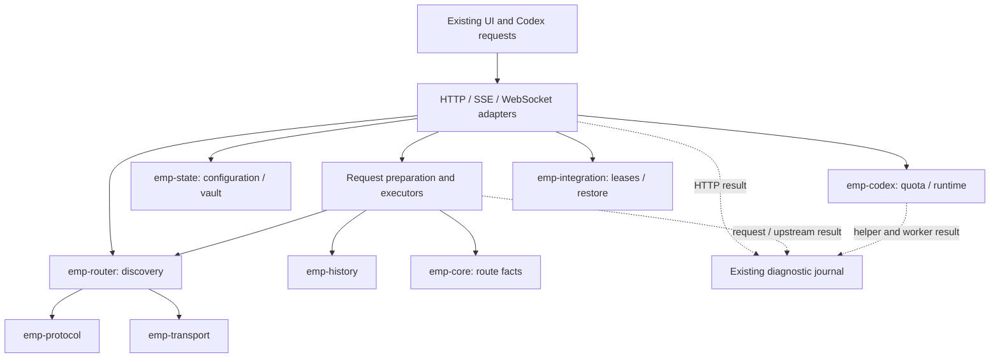
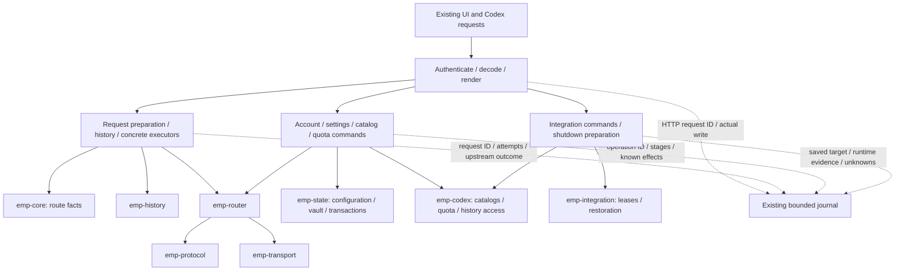

# Backend ownership: simple execution, complete evidence

[中文一页说明与前后对比](backend-workflows.zh-CN.md)

This is the current implementation contract for the eight library crates and
their composition in `emp-app`. It supersedes proposals to add availability
gates, cooldowns or recovery probes as part of this refactor. The existing UI,
routes, confirmations, source selection, retries and error contracts remain.

## Ownership of all eight modules

| Module | Owns | Application boundary / decision |
| --- | --- | --- |
| `emp-core` | Route identities, provider/model values and capabilities | Shared typed facts; retain opaque upstream fields. |
| `emp-state` | Configuration, vault, file transactions, usage and diagnostic storage | Configuration and account commands own writes; HTTP adapters do not hydrate credentials or coordinate transactions. |
| `emp-codex` | Concrete Codex history, catalogs, quota helpers and runtime observations | Catalog, account/quota and integration services own the complete user operation. |
| `emp-integration` | Configuration leases, conflict detection, restoration | Integration commands own apply/restore/search/runtime sequencing; the lease manager retains transactional authority. |
| `emp-history` | History/context preparation and compaction algorithms | Existing request preparation and history services retain ownership; preserve tool pairing and continuation behavior. |
| `emp-router` | Protocol selection, projection and upstream dispatch | Existing native/external/Claude executors retain retry and outcome decisions. Provider discovery now belongs to the catalog service. |
| `emp-protocol` | Responses/Chat/Anthropic projection and stream state | Keep the concrete protocol machines; do not impose one universal wire pipeline. |
| `emp-transport` | Connections, TLS/proxy policy, limits, framing and socket lifecycle | Executors use the existing transport; wire adapters own downstream delivery evidence. |

Crate dependency directions are unchanged. No library depends on `emp-app`. The useful
consolidation is complete-operation ownership in the application, not merging
independent protocol, persistence and transport implementations into one crate.

## Before / after

These are responsibility diagrams, not a complete crate dependency graph.
Solid arrows are execution; dotted arrows are passive evidence.

Before: model request services already existed, but management HTTP handlers
also knew locks, credentials, discovery, reset/read ordering, leases and runtime
steps. Results were recorded at different boundaries.

After: wire adapters authenticate, decode, call an operation owner and render
the existing response. The owner keeps execution order and returns its result.
Evidence reports what happened; it has no control arrow back into execution.

## Complete operations and evidence

`startup_recovery` handles unreadable configuration and missing, invalid or
mismatched credential keys before the normal backend starts. Its recovery page
uses an isolated loopback listener and an in-memory session token, with the same
origin checks as management HTTP. It holds the existing `state/service.lock`;
normal workers and Codex integration do not run during recovery. The page offers
confirmed reset or Exit, which preserves the current files. There is no manual
repair/retry flow. Developer-supplied external key overrides retain an explicit
launch diagnostic and never offer an ineffective local reset.

Confirmed reset creates fresh configuration and a new key with automatic
integration disabled. It clears only the selected configuration and its adjacent
state directory, preserving the service lock inode. Backup is optional and
unchecked by default: old files are staged for rollback, then deleted after a
successful reset unless the user selected retention. Retained backups include
the old key; they are not a model/account switching mechanism. Native Codex
files and custom external directories are untouched. Failed installation rolls
back moved files; an interrupted transaction marker blocks normal startup but
allows another confirmed reset. EMP validates the recorded archive against the
same configuration and a direct-child generated directory, then stores the next
attempt inside that archive without overwriting earlier files. Successful reset
retains or clears the entire transaction according to the current backup choice.
Malformed metadata never authorizes following or deleting an unrelated path;
only the current configuration/state is reset in that case. Cleanup failure is
reported with the remaining directory. Contracts live in
`src/startup_recovery/tests.rs`, `tests/startup_recovery.rs` and
`scripts/shadow_frontend/e2e_startup_recovery.py`.

| Operation owner | Forward execution | Evidence and limit |
| --- | --- | --- |
| `services/request_preparation`, native/external/Claude executors; wire adapters | Prepare selected route → prepare history → execute → deliver | One request ID; requested effort, selected source/model, attempts and errors. Upstream completion/accounting remains independent of local delivery. |
| `services/accounts` | Validate → serialize account → settle legacy history when needed → commit credentials/configuration → publish account result | Import/delete receipt, pseudonymous account, history and complete transaction stages. Failed public-result reading does not erase a successful commit. |
| `services/configuration/settings` | Validate → commit/reload → request existing downstream work | Saved state is separate from catalog publication and queued work. Usage scan command ID links to existing worker receipts. |
| `services/catalog/discovery` | Resolve provider/credentials → discover or read metadata → optionally commit selection/catalog | A discovery result does not imply a saved selection. Selection retains its config/catalog rollback transaction. |
| `services/catalog`, `services/account_catalog` | Publish local catalog; separately request existing subscription refresh / fetch and identity-check a subscription catalog | Requested work is not completed work. Source generation and pseudonym identify background outcomes; publication has its own result. No new polling or probes. |
| `services/migration` | After existing one-use export authorization: encrypt; or decode/decrypt → commit account bundle → publish catalog | Bundle commit and later catalog publication have separate receipts. Passwords and bundles never enter observation. |
| `services/quota/commands` | Validate account → hold existing account lock → read quota, or explicitly reset then read quota | Reset outcome (`reset`, no credit, nothing to reset, already redeemed) and follow-up read are separate. A failed follow-up read does not cause another reset. |
| `services/integration/commands` | Confirm → temporarily drain admission for restore → hold operation lock → convert coordinated idle EMP history with backups → restore search/configuration → runtime observation → summary → reopen admission | Busy or unverified history is deferred without blocking configuration restore. A native WebUI can finish deferred conversion; the same service can be enabled again. Runtime observation failure does not undo a committed restore. Only Quit EMP requests process exit. |
| `services/shutdown` | Check update and active-work constraints → restore owned integration → verify native configuration → return readiness | An applied or unresolved previous listener lease keeps EMP running. Readiness is not proof of process exit, client receipt or desktop recovery. HTTP, tray and lifecycle owners perform delivery and stopping. |

Desktop menus live in `src/tray`, with separate StatusNotifier, Windows and
AppKit adapters. Both mouse buttons open the same three-item menu. The
Linux adapter sets ksni's `MENU_ON_ACTIVATE`; Windows and macOS use tray-icon's
left/right menu flags. The action
worker invokes the existing integration and shutdown services directly. HTTP
restore/quit exempts its own admitted management request; the tray exempts zero
requests. It never treats a running model request as its own connection.
Restore Native retains the service and tray. Menu labels follow saved integration
state and language, and state-changing actions are disabled while a menu operation
is running. Startup recovery retains the same menu with activation disabled;
its HTTP worker leaves the main thread available to AppKit.

Integration command completion publishes the existing management invalidation
event for both HTTP and tray callers, including failed follow-up observations
after a committed change. Open WebUI pages fetch the current integration state
without reloading or replacing a dialog. Stream reconnect sends the initial
snapshot again; focus and the existing disconnected-stream fallback refresh it
as well. `desktop_tray_started` records successful native event-loop setup.

Open WebUI issues a fresh, single-use ten-minute bootstrap link through one
in-memory desktop token slot. Replacing that slot invalidates an unopened older
desktop link. The original startup token, header-based management sessions,
Host/Origin checks and failed-persistence retry behavior retain their boundaries.
No new management HTTP endpoint or persisted desktop credential is introduced.

OS exit notifications are owned by `lifecycle/signals` and the Windows session
window in `lifecycle/windows`. They register before startup integration is
applied. Terminal close, interrupt, hangup and confirmed session end close
admission permanently and restore owned configuration before worker or
credential drains. A canceled session-end query does neither. The Windows
session callback completes local restoration before returning to the OS; all
cleanup runs inside the exiting EMP process. Normal shutdown then gives admitted
handlers up to 30 seconds to finish and flush their request receipts; a drain
timeout is reported rather than claimed as a clean exit. `RestoreBeforeExit` also covers a
Rust stack unwind, but cannot run after forcible process termination.

Exit restoration checks the persisted instance identity under the operation
lock. It restores unchanged EMP-owned fields independently of external edits,
retains conflicting fields and reports the conflict. Each exit lock wait is
limited to 400 ms. Runtime observation releases the operation lock before IPC
and rejects results if the configuration changed meanwhile. Only a requested
update handoff retains integration for the replacement executable. Neither file
restoration nor these exit checks prove an already-open client reloaded its
configuration. The process contracts are in `tests/exit_process.rs`.

Updates, usage scans, startup and shutdown workers retain their existing
phase/command receipts and lifecycle owners. Migration commands retain the existing
HTTP confirmation and account transaction owner. These are not silently folded into
a fire-and-forget event bus. Existing notification coalescing remains intact.

## Observation contract

`services/observation/operation` can access diagnostic storage only. Command
owners supply fixed stage/fact names, fixed values, numeric generations and
tri-state checks. It never receives config snapshots, credentials, request
bodies, model replies, paths or arbitrary upstream errors. Account identities
are pseudonymized. Each receipt records `operation_id`, the trusted HTTP
`request_id` when present, stages, checks, duration and outcome. Request IDs
come from the connection owner, never a caller-supplied header. Direct service
calls have no HTTP parent.

`completed` means the command returned success under its existing contract.
`checks` use `true` / `false` / `null` for match / mismatch / unobserved. Missing
checks have not been reached. A successful saved write does not prove runtime
load; a live model-list result does not prove routing or desktop restoration.
`client_effect` stays unknown; correlate the HTTP receipt for the local write.

An ignored failure remains a failed stage inside a completed command. Panics
leave an interrupted receipt during unwinding. Process death, rotation or a
disabled journal can leave gaps. Journal I/O failure never changes the command
result or repeats it. These limits are evidence boundaries, not new policies.

## Acceptance checklist

- [x] Eight library responsibilities and their application owners are mapped.
- [x] Discovery, integration, migration, quota and quit orchestration moved out of HTTP.
- [x] Account/configuration/catalog operations have passive stage receipts.
- [x] HTTP correlation, queued work, persisted state and observed effects are distinct.
- [x] No new network probes, scheduling policy, routing or retry decisions.
- [x] The observation refactor itself changes no public endpoint, response schema, UI sequence or confirmation.
- [x] Tests use temporary Codex homes; fault injection asserts its temporary path.

Verification is through the existing config, catalog, quota, account race,
integration, HTTP/SSE/WebSocket, native and Claude contract suites. New
`management_operation_contract` cases exercise committed configuration followed
by failed publication, early rejection/privacy, parent HTTP correlation and
applied configuration with unverified runtime. The observer's unavailable-log
test checks exact result preservation and single execution. Test fixtures do
not establish real-provider or real-desktop acceptance.

## v0.13.3 close-out verification

The release keeps account deletion, credential identity, migration preference
resolution, OS exit handling and startup recovery with their respective owners.
Compared with v0.13.1, the application account module is 625 lines instead of
712, state accounts is 382 instead of 481, and lifecycle is 189 instead of 266.
This does not remove the cross-module contracts for persistence and shutdown.
Recovery drops the unused reset-availability flag and retired page styles;
account fixtures explicitly initialize their credential store before startup.

Isolated ablations removed the missing-key rejection and pending-reset rejection
individually. The corresponding recovery behavior tests failed in both cases;
both protections remain. The import E2E likewise detects removing the unresolved
preference guard. Transaction rollback, credential ownership and cancellation
checks are retained rather than replaced by assertions about implementation.

Linux application regression passes 319 tests, with 19 installed-engine or
environment-specific cases explicitly ignored. Firefox acceptance exercises the
embedded production UI, actual configuration saves, encrypted migration,
optional recovery backup and return to management. Development review adapters
and mock-action routes are absent from the normal executable's HTTP surface.
Fixtures use temporary homes and synthetic credentials; no paid provider is
called. Native packaging also gates startup recovery and exit-process tests on
Windows, Linux and both macOS architectures. Those automated checks do not
establish acceptance of a user's desktop App, IDE, logoff or shutdown session.

The unpublished v0.13.2 package run exposed a Windows test prerequisite:
`GetConsoleWindow` returned `PseudoConsoleWindow`, whose WM_CLOSE destroyed
only the proxy HWND while EMP remained alive. The disposable Windows CI runner
now selects Windows Console Host, and the test requires `ConsoleWindowClass`
before posting the actual close event. See Microsoft's
[console window semantics](https://learn.microsoft.com/en-us/windows/console/getconsolewindow)
and [terminal preference values](https://learn.microsoft.com/en-us/windows/terminal/group-policy).
This changes CI configuration only, not a user's terminal settings. Running
this particular test locally requires Windows Console Host as the default.
The cancellation fixture starts its five-second deadline after the test client
disconnects; waiting for a management snapshot must not spend that deadline.
