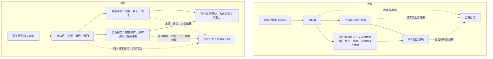

# EMP 后台改造：一页工作约定

[状态流程清单：负责人模块、转换边界与验证入口](state-lifecycles.md)

**目标：做事的路径简单明确，检查结果的证据完整，保持现有使用逻辑。**

此次整理覆盖八个底层模块和 `emp-app` 的组织方式。重点合并重复职责、
让完整操作有明确负责人。账号选择、模型选择、按钮、确认、重试和恢复规则沿用原行为。
观测负责说明结果，不新增拦截、换源、重放或恢复探测。

## 前后对比

实线表示执行，虚线表示记录事实。

统计查询先复用带原始时间戳的明细，再按时间范围、服务和模型计算报表。
`usage/ledger/read_cache.rs` 分别为调用与用量保留一份磁盘临时表。
较短周期复用已有明细，重叠扩展只读取缺少的范围，并移除滚出最大查询窗口的明细。SQLite `data_version`
在新增记录、历史修正、发送状态更新和重新计价后使缓存失效。
会话名称与父子归属在查询时关联；前端仍只接收聚合结果和分页记录。

## 八个模块各管什么

| 模块 | 职责 |
| --- | --- |
| `emp-core` | 来源、模型和路由的共同定义 |
| `emp-state` | 配置、凭据存储、事务、用量和日志存储 |
| `emp-codex` | Codex 目录、历史读取、额度辅助进程和运行状态 |
| `emp-integration` | 接入配置的占用关系、冲突判断和恢复 |
| `emp-history` | 历史整理、上下文和压缩算法 |
| `emp-router` | 协议选择与上游调度 |
| `emp-protocol` | 不同模型协议的格式转换和流式状态 |
| `emp-transport` | 连接、代理、TLS、传输限制和收发 |

`emp-app` 中的操作服务负责把这些能力按原有顺序组织起来。
接口层不再亲自串联发现、额度重置、迁移、接入恢复和退出步骤。

`services/request_facts.rs` 集中解释请求字段。记忆路由、计量和被动日志分别使用它，
计量不再反向依赖日志或路由策略。请求准备在入口确认正文是对象，内部转换直接接收
该对象；配置使用已有的快照接口。这些调整不增加运行状态或恢复策略。

Chat 完整响应由 `chat_response.rs` 转换；`chat_stream.rs` 管增量状态，
`chat_stream/events.rs` 管事件生成。两条路径共用正文读取规则，工具参数只解析一次，
再把确定的 JSON 对象交给自定义工具转换。普通函数调用保留原始参数文本。
流式转换直接借用输入，并把完成的工具项移入最终响应。

账本负责记录已完成的历史重发关联，使用诊断模块已有的范围匹配；不扫描旧历史，
也不增加一次成功推理。无状态 WebSocket 的发送层只调整下游完成事件的 ID，
计量先读取原始事件。

`services/cpa_quota.rs` 负责 observer 解析、启用且有效账号的汇总、最近重置时间和
按凭据区分的快照缓存。服务额度接口分派本机 Claude 与 CPA 查询；界面复用
订阅额度组件和已有悬停／焦点气泡。此路径不发起模型请求。
`cpa_quota/history.rs` 将号池与各账号的 5h／7d 观测写入已有额度 SQLite，
按 CPA 凭据隔离。共用后台采样任务复用五分钟快照缓存；趋势接口只读本地历史，
不再查询 observer。历史保留十五天。

余额适配器负责确认官方地址、保存解析后的查询地址和解析余额。余额服务直接调用
`OfficialService`，不再重复解析 URL 或选择服务商路径。正式界面和 Shadow 均使用
后端返回的支持范围。Shadow 的跨版本元数据转换集中在 `real_config.py`；
HTTP 处理器只负责鉴权和只读转发。

## 每次操作应能回答

1. **要求做什么？** 操作名、选定来源和模型；不记录会话正文和凭据。
2. **实际做到哪一步？** 各阶段、耗时、结果，以及原有执行器实际尝试情况。
3. **什么已经生效？** 配置提交、目录发布、运行目录观测分别记录。
4. **什么仍不能确定？** 未执行的检查和不能观测的客户端效果明确保留未知。

例如：“偏好已保存，但目录写入失败”会同时保留这两个事实；
“重置返回无可用权益”不会被记录成已消耗权益；
“Codex 模型目录吻合”不能推导出请求路由或桌面恢复也已验证。
检测结果只进入记录，不反过来改变业务动作。

## 完成依据

- 请求观测与管理操作观测都归入整体架构，使用 HTTP 请求编号关联。
- 账号、配置、目录、额度、迁移、接入和退出都有明确操作负责人。
- 原有异步任务继续区分“已请求”和“已完成”。
- 验收检查成功、局部失败、未知、日志故障和原有接口行为。
- 本地模拟和 CI 通过不等于真实账号、桌面环境已验收。

[开发者职责与验收说明](backend-workflows.md) · [日志字段约定](diagnostic-journal-spec.md)
