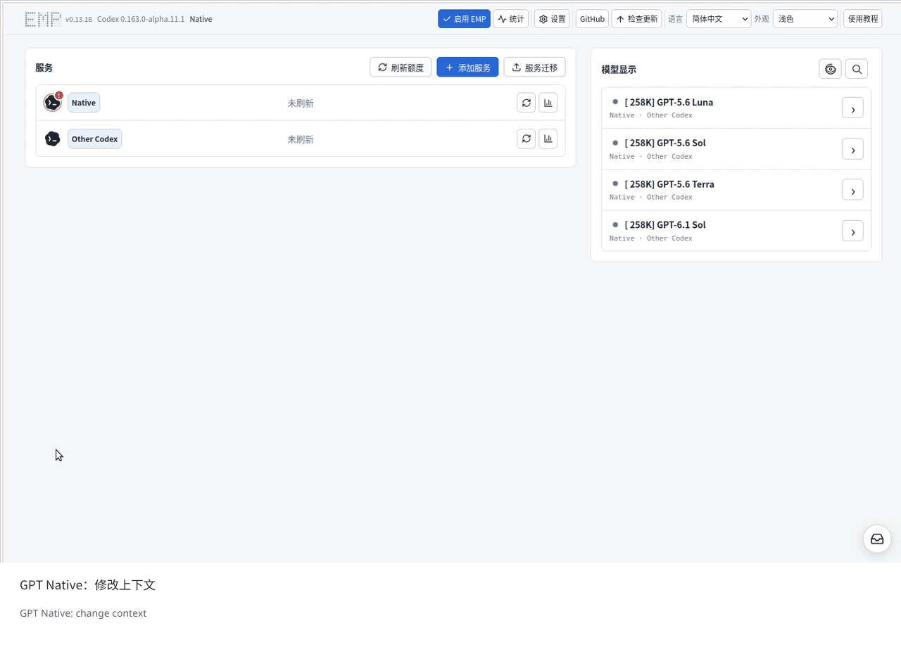
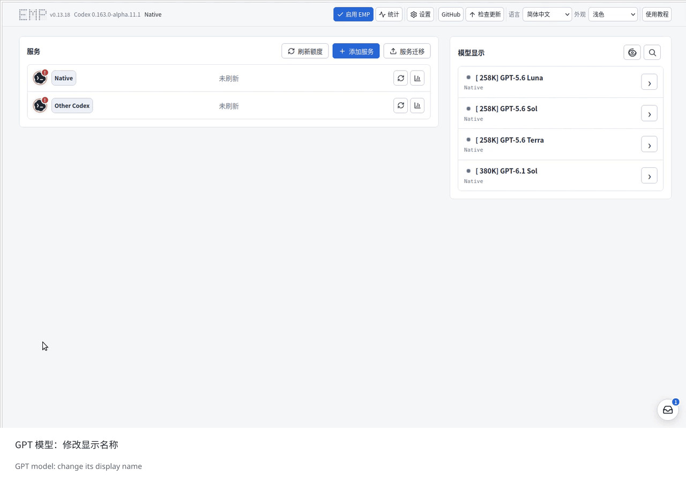
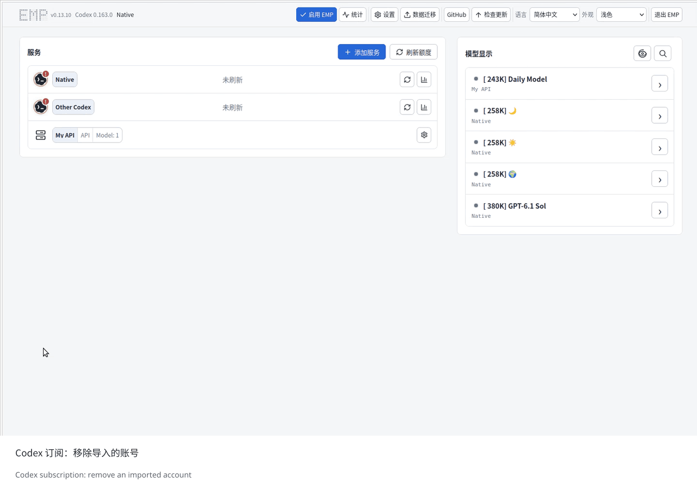
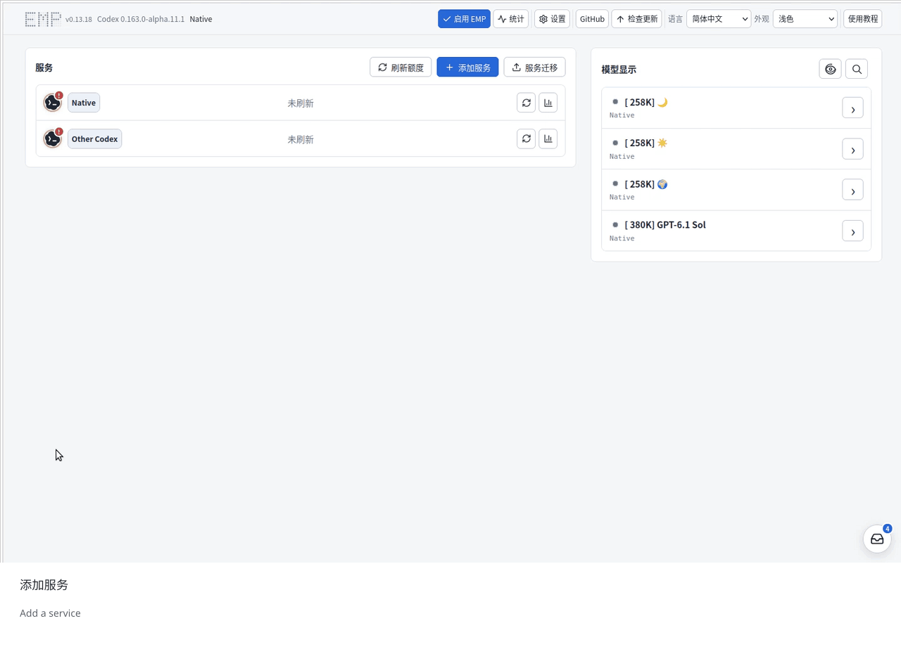
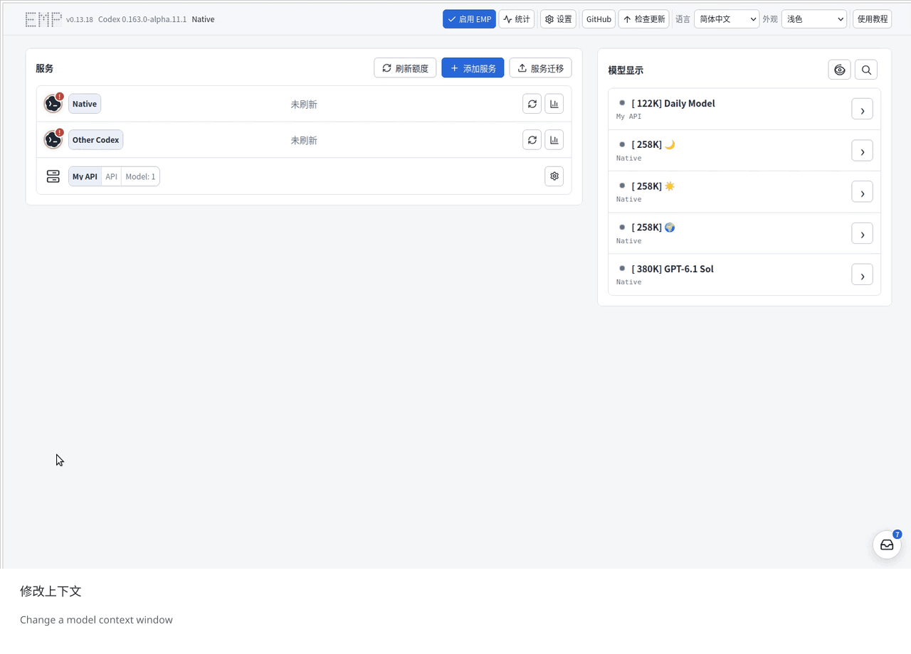
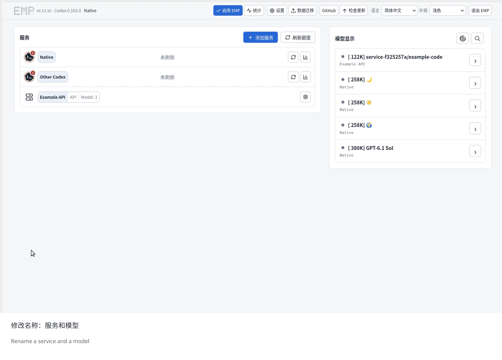
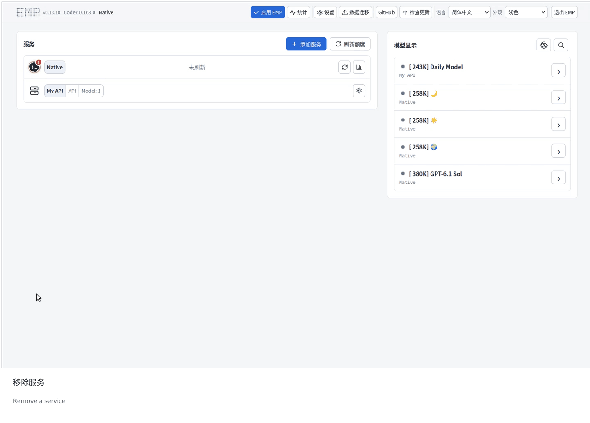
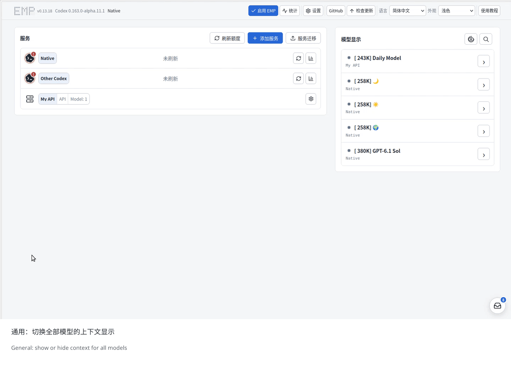
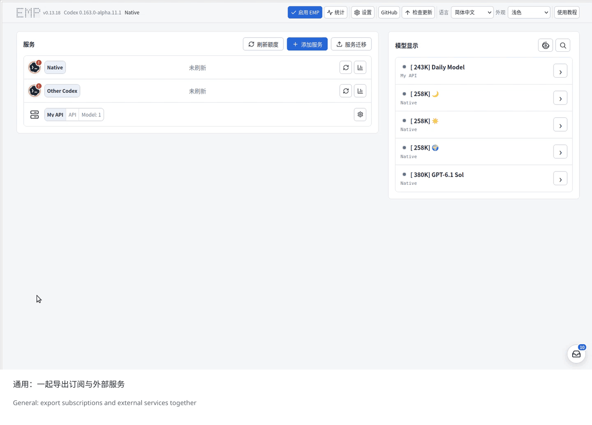
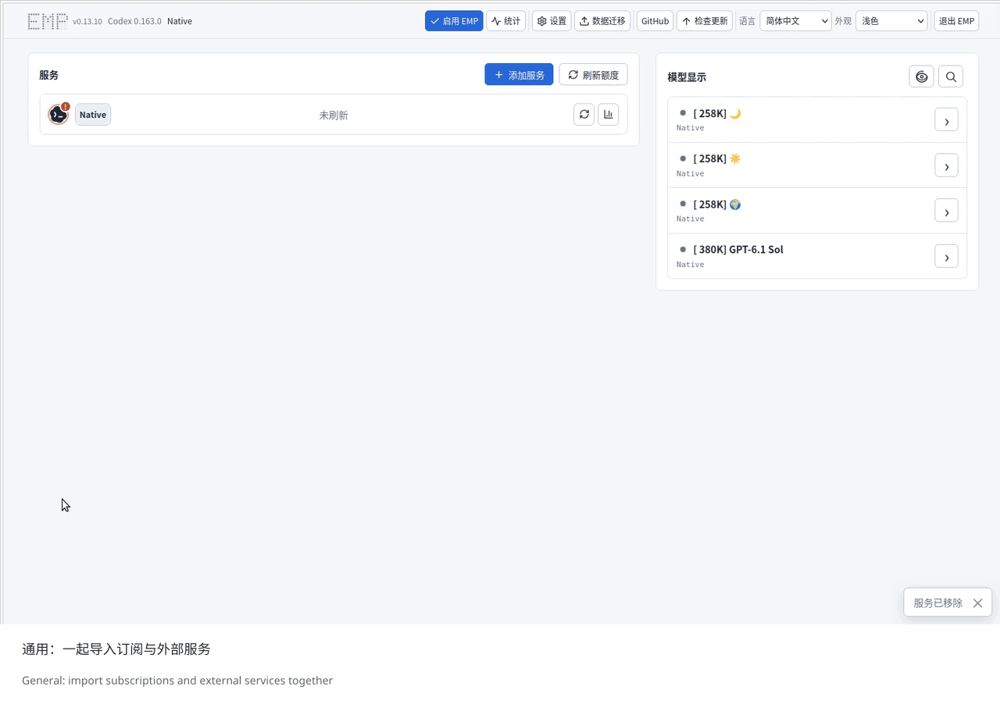

# Quick Tutorials / 快速教程

[English README](../README.md) · [中文 README](../README.zh-CN.md)

Expand a task to view its GIF. Each recording uses the actual EMP interface with
sample data, a Chinese UI, and Chinese and English captions.

展开需要的操作即可观看 GIF。录屏使用实际 EMP 界面与示例数据，界面为简体中文，附中英字幕。

## GPT Models and Subscriptions / GPT 模型与订阅

1. Change Native GPT context / 修改 Native GPT 上下文

Open **Native → Model settings**, edit the model's context window, and save.
The available limit comes from your account's model catalogue.

点击 **Native → 模型设置**，修改对应模型的上下文并保存。可填写的上限以自己账号的模型目录为准。

[View full size / 查看大图](assets/tutorials/00-native-context.gif)

2. Rename GPT models / 修改 GPT 模型显示名称

Use the arrow beside a model to change its display name. This example renames
GPT-5.6 Sol, Terra, and Luna to ☀️, 🌍, and 🌙, saving each one.

点击模型右侧箭头修改显示名称。示例把 GPT-5.6 Sol、Terra、Luna 分别改为 ☀️、🌍、🌙 并逐个保存。

[View full size / 查看大图](assets/tutorials/00-native-name.gif)

3. Remove an imported Codex subscription / 移除导入的 Codex 订阅

Open the imported account and select **Remove**. Removing it from EMP keeps
the current Native sign-in.

点击导入的账号，选择 **移除** 并确认。本机 Native 登录保留。

[View full size / 查看大图](assets/tutorials/00-remove-subscription.gif)

## External API Services / 外部 API 服务

4. Add a service / 添加服务

Open **Add service**, enter the connection details, save, then update the model
list and show the model you want to use. Preset services fill in their connection
details; use your own API key.

点击 **添加服务**，填写连接信息并保存，再更新模型列表、显示要使用的模型。预设服务会填好连接参数，填写自己的 API Key 即可。

For Mercury 3, select **Inception / Mercury**, then import `mercury-3` from its
model list. [Inception API setup](https://docs.inceptionlabs.ai/get-started).

Mercury 3 可选择 **Inception / Mercury**，再从模型列表导入 `mercury-3`。

[View full size / 查看大图](assets/tutorials/01-add-service.gif)

5. Change an external model's context / 修改外部模型上下文

Open the service's **Model settings**, edit the model, set the supported context
window, and save.

打开服务的 **模型设置**，编辑模型，填写服务实际支持的上下文并保存。

[View full size / 查看大图](assets/tutorials/05-change-context.gif)

6. Rename a service and a model / 修改服务和模型名称

Change the service name in **Connection settings**. Use the arrow beside a
model to change its display name; its upstream model ID stays the same.

在 **连接设置** 修改服务名称；点击模型右侧箭头修改模型显示名称，上游模型 ID 保持不变。

[View full size / 查看大图](assets/tutorials/06-rename.gif)

7. Remove an external service / 移除外部服务

Open the service, select **Remove**, and confirm. Its models are removed from
EMP with it.

点击要移除的服务，选择 **移除** 并确认，EMP 会同时移除该服务的模型。

[View full size / 查看大图](assets/tutorials/04-remove-service.gif)

## Shared Controls / 通用操作

8. Show or hide context labels for all models / 切换全部模型的上下文显示

The eye control above the model list shows or hides context labels for both
GPT models and external models. It keeps the configured context windows.

模型列表上方的眼睛开关统一显示或隐藏全部 GPT 和外部模型的上下文标签，不改变实际上下文设置。

[View full size / 查看大图](assets/tutorials/07-context-label.gif)

9. Export subscriptions and external services / 一起导出订阅和外部服务

Open **Data migration → Export**, select the services, set an export password,
and download the `.emp` file. One package can contain both Codex subscriptions
and external API services. Keep the file and password together for importing.

打开 **数据迁移 → 导出**，选择服务，设置迁移密码并下载 `.emp` 文件。同一个包可以包含 Codex 订阅与外部 API 服务；导入时需要该文件及密码。

[View full size / 查看大图](assets/tutorials/03-export-service.gif)

10. Import subscriptions and external services / 一起导入订阅和外部服务

Open **Data migration → Import**, choose the `.emp` file, enter its password,
and open the package. Review and select the subscriptions and external services,
then select **Import**.

打开 **数据迁移 → 导入**，选择 `.emp` 文件，输入迁移密码并打开迁移包。核对并勾选订阅与外部服务后，点击 **导入**。

[View full size / 查看大图](assets/tutorials/02-import-service.gif)

